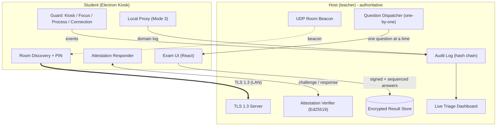

# Zero Trust LAN Exam System (ZT-Exam)

An offline-first, Zero-Trust exam platform for computer labs over a local network (Minecraft-LAN style).
One Electron app plays two roles: **Host (teacher)** and **Student Kiosk**. No cloud required during the exam.

> Design docs (Thai): [`design.md`](./design.md), [`ai-docs-dev/project-arc.md`](./ai-docs-dev/project-arc.md), [`ai-docs-dev/tech-stack.md`](./ai-docs-dev/tech-stack.md)

---

## Table of Contents

- [What It Does](#what-it-does)
- [Design Principles](#design-principles)
- [Features](#features)
- [Exam Modes](#exam-modes)
- [Architecture](#architecture)
- [Tech Stack](#tech-stack)
- [Project Structure](#project-structure)
- [Getting Started](#getting-started)
- [Usage](#usage)
- [Scripts](#scripts)
- [Security Model](#security-model)
- [Threat Model & Limitations](#threat-model--limitations)
- [Screenshots](#screenshots)
- [Roadmap](#roadmap)
- [License](#license)

---

## What It Does

- Host creates a room on LAN, publishes questions, controls time, and monitors students live.
- Students discover the room via UDP broadcast, join with a short **Room PIN**, and take the exam in a locked-down **kiosk window**.
- Questions are dispatched **one at a time** from the host — future questions never live on the student machine.
- Every suspicious event (focus loss, forbidden process, network bypass, integrity mismatch, heartbeat loss) is streamed to the host in real time and stored in a **hash-chained audit log**.
- The host dashboard **triages** who to check instead of watching everyone, with per-student evidence timelines, live screen thumbnails, and 5-minute on-demand screen replay.

---

## Design Principles

1. **Detect & Report, not perfect prevention** — make cheating not worth it, and leave evidence when it happens.
2. **Host-authoritative** — the teacher machine is the source of truth for questions, time, answers, and audit logs. Student clients are never trusted.
3. **Minimize data on student machines** — one question at a time, encrypted 5-minute screen ring buffer kept locally until the proctor pulls it.
4. **Fail-closed** — heartbeat or attestation failure freezes the exam and alerts the host immediately.
5. **Honest about limits** — software alone cannot stop phone photos, neighbors peeking, or hidden hypervisors. Those are handled by lab policy + proctors + watermark tracing (see Threat Model).

---

## Features

### Host (Teacher)

- Room creator: exam mode, whitelist/blacklist policy, duration, PIN.
- Live dashboard: student grid, connection status, suspicion scores, live audit feed.
- Triage workflow: Normal / Watch / Critical severity, weighted suspicion score, per-student evidence timeline, acknowledge + note, warn, freeze, critical-only alerts (no alert fatigue).
- Screen monitoring: ~1 fps thumbnails for all students, click-to-view live + up to 5-minute replay (pulled on demand, audited).
- Exam control: Start / Freeze / Resume / End, per-module builders and graders.
- Result store: encrypted SQLite (`better-sqlite3` + AES-256-GCM), CSV/Excel export, `.ztresults` bundles.
- Attestation verifier: Ed25519 signed manifest + TLS-bound challenge-response, re-challenged at random intervals.

### Student (Kiosk)

- Room discovery (UDP beacon) + manual join + PIN-verified host fingerprint (HMAC, beacons alone are spoofable).
- Kiosk HUD: countdown (host clock), connection badge, single primary action per question.
- Question types: MCQ, short answer, essay (core), plus pluggable modules below.
- Watermark overlay (per-student trace), proctor overlay / frozen / time-up fail-closed screens.
- Autosave + crash recovery, connection loss handling, focus/kiosk/process/connection/overlay/clipboard guards reporting to host.
- Dark/light theme (default dark), Thai-first UI, `shadcn`-style component system, offline `file://` safe (no CDN fonts).

### Pluggable Exam Modules (`src/modules/`)

| Module | Status | What it adds |
|---|---|---|
| `dynamic-form` | Implemented | Google-Forms-style builder, 12 input types, per-question keys & points, `.ztform` save/load, per-student shuffling, auto-grading, re-grade whole room, CSV/Excel export |
| `code-ide` | Implemented (Phases 8–11) | In-app Monaco IDE (Java, Python, HTML/CSS, React, JS, TS), multi-file tree, test console, external runtimes (`javac`/`java`, `python`, `node`), offline `esbuild` + headless DOM runner (`jsdom`), hidden test-case grading, parallel queue, code diff/playback inspector |
| `external-url` | Planned (Phase 12) | Whitelisted external exam URL wrapped in `WebContentsView` |

Core platform (network, security, detection, triage, screen, kiosk shell) never needs to change to add a new module — modules register via `ExamModuleRegistry` with a 4-part contract (`shared` schemas, `main` backend, `renderer/host`, `renderer/student`).

---

## Exam Modes

Selected by the teacher at room creation:

| Mode | Description | Student network |
|---|---|---|
| **1. Closed** | Full-screen kiosk, in-app questions only | LAN to host only, no internet |
| **2. In-App Docs** | Split view: questions + `WebContentsView` docs | URL whitelist enforced in WebView, violations reported |
| **3. External Tools** | Allows outside tools (e.g. controlled VS Code) | Local CONNECT proxy logs/reports domains (default-deny whitelist, proxy-side DNS), Connection Monitor flags off-proxy traffic |

Per-room policy: `enforcement: report-only | block-and-report` (Mode 3 defaults to `report-only`).

**Mode 3 VS Code control:** launched with app-owned `--user-data-dir` / `--extensions-dir`, pre-installed hash-verified extensions, AI features disabled via settings, Marketplace off, Integrity Watchdog hashes settings/extensions during the exam.

---

## Architecture



Student machines only talk to the host. Cloud sync (if used) is post-exam upload by the host.

**Screen monitoring flow:** student captures all displays → encrypted 10s segments in a local 5-minute ring buffer + ~1 fps JPEG thumbnails over TLS → host pulls segments on demand (live 720p/30fps over raw UDP + AES-256-GCM with TCP/JPEG fallback, handshake over TLS) → every view is audit-logged. Critical events pin surrounding segments so they are not overwritten.

---

## Tech Stack

| Layer | Technology |
|---|---|
| Desktop runtime | Electron 45 (same Chromium on Windows / macOS / Linux) |
| Language | TypeScript 7 |
| UI | React 19 + Vite + Tailwind CSS v4 + shadcn-style copied components (Radix primitives, `sonner` toasts, `lucide-react` icons) |
| State | Zustand 5 |
| Validation | Zod 4 (every network + IPC message) |
| Host result DB | `better-sqlite3` + field-level AES-256-GCM |
| OS signals | `systeminformation` (processes, sockets, interfaces) |
| Ephemeral TLS cert | `selfsigned` (fresh self-signed cert per room, TLS 1.3) |
| Native hook | `node-addon-api` N-API addon (low-level keyboard hook, overlay inspector) |
| Packaging | `electron-builder` (NSIS / DMG / AppImage+deb) + `@electron/fuses` hardening |
| Tests | Vitest 5 |
| Code module | `monaco-editor` (offline IDE), `esbuild` (offline bundling), `jsdom` (headless DOM grading) |
| Built-ins | Node `dgram`, `tls`, `net`, `crypto` (UDP discovery, TLS, Ed25519, AES-GCM) |

See [`ai-docs-dev/tech-stack.md`](./ai-docs-dev/tech-stack.md) for the verified version catalog and [`electron.vite.config.ts`](./electron.vite.config.ts) for the build wiring.

---

## Project Structure

```text
lan-exam-system/
├── ai-docs-dev/            # Architecture, tech stack, phased plans (Phase 0-12)
├── native/                 # N-API addon (keyboard hook, window/overlay inspector)
├── scripts/                # keygen, sign/verify manifest, apply fuses, afterPack
├── samples/                # sample-exam.json (Phase 2 showcase)
├── screenshots/            # UI tour (30 stills + tour.mp4)
├── src/
│   ├── shared/             # Zod schemas, IPC contracts, protocol + module-contract.ts
│   ├── main/               # Electron main (Core Platform)
│   │   ├── network/        # UDP discovery, TLS 1.3 server/client, framing
│   │   ├── host/           # Session manager, timer, audit hash chain, triage engine
│   │   ├── guard/          # Process / overlay / network / input / VM detection
│   │   ├── screen/         # Capture manager, encrypted ring buffer, stream controller
│   │   ├── proxy/          # CONNECT proxy + VS Code controller (Mode 3)
│   │   ├── attestation/    # Ed25519 manifest + TLS-bound challenge
│   │   ├── browser/        # WebContentsView docs host (Mode 2)
│   │   └── storage/        # Encrypted SQLite result store
│   ├── preload/            # Sandboxed contextBridge (typed Core + Module bus API)
│   ├── renderer/src/
│   │   ├── core-host/      # Room creator, triage dashboard, screen viewer
│   │   ├── core-student/   # Join room, kiosk HUD, watermark, freeze screens
│   │   ├── components/ui/  # shadcn-style primitives (button/input/dialog/tabs/...)
│   │   └── store/          # Zustand stores
│   └── modules/
│       ├── registry.ts / register-modules.ts
│       ├── dynamic-form/   # shared/ + main/ (dispatcher, grader, .ztform I/O) + renderer/
│       └── code-ide/       # shared/ + main/ (runner, grader) + renderer/ (Monaco IDE)
├── electron-builder.yml
├── electron.vite.config.ts
└── package.json
```

Renderer runs with `nodeIntegration: false`, `contextIsolation: true`, `sandbox: true` — all main access goes through the preload bridge.

---

## Getting Started

### Prerequisites

- Node.js 20+ (22 LTS recommended)
- npm 10+
- Windows 10+/11, macOS 13+, or Linux (X11 recommended for screen capture; Wayland needs portal approval each time)
- For native rebuilds: Python 3 + C++ build tools (`node-gyp`)
- For packaging: platform signing certs as needed (Windows Authenticode, macOS signing + notarization)

### Install

```powershell
npm install
npm run build:native   # rebuild better-sqlite3 / os_guard addon
```

### Develop (two windows: host + student)

```powershell
npm run dev:host       # host role
npm run dev:student    # student kiosk (windowed for dev)
# or both side-by-side:
npm run dev:pair
```

Single default entry (`--profile=host --role=host`):

```powershell
npm run dev
```

### Verify

```powershell
npm run typecheck   # tsc for node + web projects
npm test            # vitest suite (run under Electron as node)
npm run build       # electron-vite build (must stay file:// + offline safe)
```

### Package

```powershell
npm run package:win
npm run package:mac
npm run package:linux
```

Fuses are applied via `scripts/apply-fuses.ts` (`afterPack`); release manifests are signed outside the repo:

```powershell
npm run keys:generate
npm run manifest:sign
npm run manifest:verify
```

> The Ed25519 **private signing key never lives in this repo**. Forks without a signature the host trusts cannot join a room.

---

## Usage

### Host flow

1. Launch app as **Host** → Create room (pick exam module, mode, duration, network policy).
2. Show the **Room PIN** on screen; students use it to verify the host fingerprint.
3. Load questions (paste JSON / import `.ztform` / use module builder, e.g. Form Builder or Code Problem Builder).
4. Start the exam → watch the triage dashboard (suspicion-ranked list, audit feed, thumbnails).
5. Click a flagged student → view evidence timeline → warn / freeze / mark reviewed + note.
6. End exam → review submissions / grading views → export CSV/Excel / `.ztresults`.

### Student flow

1. Launch app as **Student** → pick discovered room (or manual host:port) → enter Room PIN.
2. Wait in lobby → exam auto-starts on host signal.
3. Answer one question at a time (Back allowed only when the question permits; parameters/choices shuffled per student).
4. Docs (Mode 2) or controlled VS Code (Mode 3) appear when the room allows them; anything else raises an event.
5. On disconnect/heartbeat loss the client fail-freezes and the host is alerted; autosave enables crash recovery.

Try the bundled example: [`samples/sample-exam.json`](./samples/sample-exam.json) (randomized arithmetic MCQ + short answer + essay).

---

## Scripts

| Script | Purpose |
|---|---|
| `dev` / `dev:host` / `dev:student` / `dev:pair` | Dev windows for host, student kiosk, or both |
| `build` | `electron-vite build` (main + preload + renderer) |
| `typecheck` | `tsc --noEmit` for node and web configs |
| `test` / `test:watch` | Vitest run / watch (under Electron node) |
| `build:native` | `node-gyp` rebuild of `native/` addon |
| `keys:generate` | Generate Ed25519 keypair (dev only, key stays out of repo) |
| `manifest:sign` / `manifest:verify` | Sign / verify release file manifest |
| `fuses:apply` | Apply Electron Fuses post-pack |
| `package:win` / `package:mac` / `package:linux` | Build + package per OS |

---

## Security Model

- **Transport:** TLS 1.3 with per-room ephemeral self-signed cert; host fingerprint verified via Room PIN (HMAC) — raw UDP beacons are never trusted alone.
- **Protocol:** every message Zod-validated, answers sequenced + HMAC-signed (replay/tamper resistant), host-clock timing.
- **Attestation (Arma-3 style):** release manifest = SHA-256 of all files signed with offline Ed25519 private key; host holds only the public key; client answers nonce challenges with TLS-exporter-bound HMAC at random intervals. No TPM/hardware root of trust — raises cost, not a guarantee.
- **Detection suite:** kiosk/focus monitor, process monitor (PE VersionInfo/Bundle-ID aware, catches renames), millisecond open-close polling with randomized intervals, stealth overlay (`WDA_EXCLUDEFROMCAPTURE`), OS DNS cache, synthetic input (`LLKHF_INJECTED`, blocked + reported), cross-device clipboard, VM/remote heuristics, integrity watchdog (app + VS Code profile/extensions), launch guard (dangerous CLI flags/env), connection monitor vs. allowlist, heartbeat. Signed per-room policy — real blacklist lives on the host, not in the repo.
- **Runtime/injection hardening:** Windows process mitigation policies (extension points, remote/low-integrity image load, CFG) + runtime integrity guard (executable/resources/command-line binding, loaded-module allowlist on Windows/Linux/macOS, injected-thread detection, known injector tools), accessibility/UIA exfiltration guard with the Electron accessibility tree disabled during exams. These are **detect & report + raise cost**, not a hardware root of trust — see Threat Model.
- **Audit log:** append-only hash chain (`hash(prev_hash + event)`) on the host; back-editing is detectable; used as evidence for human judgment, never auto-conviction.
- **Hardening:** Electron Fuses (`runAsNode` off, `onlyLoadAppFromAsar`, asar integrity validation, Node CLI/inspect flags off), launch-guard self-exit on suspicious flags, `setContentProtection` where supported, code signing per platform.
- **Data:** TLS in transit + AES-256-GCM at rest on host; per-session screen-buffer keys destroyed after exam; no RAM-encryption theater (current question is necessarily plaintext in renderer).

---

## Threat Model & Limitations

| Threat | Handling |
|---|---|
| LAN eavesdrop / tamper | **Prevented** (TLS 1.3 + PIN-verified fingerprint) |
| Modified app / fake client | **Mostly detected** (signed manifest + TLS-bound challenge) |
| AI / remote / forbidden apps | **Detected & reported** (process + connection monitors); fast open-close or renames narrow the window but other sensors overlap |
| UI Automation / accessibility reading | **Detected & reported** (`AccessibilityGuard`) + Electron accessibility tree disabled during exams; synthetic input is blocked/reported (`LLKHF_INJECTED`) |
| Runtime injection / wrapper | **Mitigated + detected** (Windows process mitigations, executable/resources/command-line binding, module allowlist incl. macOS, injected-thread + injector-tool detection); no hardware root of trust still |
| Leaked future questions | **Greatly reduced** (one-by-one dispatch) |
| Peeking at neighbors | **Reduced** (per-student shuffle/parametrization) |
| Screen photos / second phone / outside helper | **Not preventable** — watermark tracing + lab rules + proctors |
| VM / hypervisor / kernel cheats | **Not fully preventable** (no hardware root of trust) — raises attacker cost |
| Admin-privileged cheater | Can bypass OS-level controls — rely on detection + evidence; run lab machines as standard users |
| On-device AI via allowed web | Contained by minimal default-deny whitelist (`block-and-report` for strict rooms); proxy sees domain level only |
| Source readers dodging rules | Per-room signed policy + randomized poll timing (rules not hardcoded in repo) |

**Highest-ROI environment (outside code):** invigilated lab, standard-user locked-down machines (no USB boot/self-install/VMs), phones collected at the door, AI-resistant question design (exam-specific files/code/context, tight per-question time, oral spot-checks after flags).

---

## Screenshots

All stills live in [`screenshots/`](./screenshots/) plus `tour.mp4`:

- Roles & themes: `01-role-dark.png`, `02-role-light.png`
- Host: room setup (`03`, `14`), lobby (`05`), running (`06`), docs/AI policy (`07`), approve dialog (`08`), finished (`09`), evidence (`10`), freeze dialog (`11`), screen viewer (`12`), attestation dev (`13`)
- Student: manual join (`15`), waiting (`16`), MCQ (`17`), essay guard (`18`), docs mode (`19`), frozen (`20`), completed (`21`), time-up (`22`), light theme (`23`)
- Modules: form builder (`24`), responses (`25`), code builder (`26`), code submissions (`27`), student IDE (`28`), code grading (`29`), code inspector (`30`)

---

## Roadmap

Detailed per-phase plans: [`ai-docs-dev/plan/00-overview.md`](./ai-docs-dev/plan/00-overview.md)

- [x] Phase 0 — Foundation & scaffolding (electron-vite, TS, React, Tailwind, typed IPC, crypto, SQLite)
- [x] Phase 1 — Network core (UDP discovery, TLS 1.3, PIN auth, framing, heartbeat/reconnect)
- [x] Phase 2 — Exam core MVP (one-by-one dispatcher, shuffle, watermark, autosave/recovery, kiosk)
- [x] Phase 3a — Deep cheat detection (+ domain recorder & host allowlist)
- [x] Phase 3b — Audit hash chain & triage dashboard
- [x] Phase 3c — Screen monitoring (multi-display, 1 fps thumbnails, 5-min encrypted ring buffer, pin-on-critical, UDP live + fallback)
- [x] Phase 4 — Attestation & hardening (Ed25519 manifest, TLS-bound challenge, native hook, fuses)
- [x] Phase 5 — Modes 2 & 3 (WebContentsView docs + controlled VS Code + CONNECT proxy)
- [x] Phase 6–7 — `dynamic-form` module (builder + backend + auto-grading + CSV/Excel + `.ztform`)
- [x] Phase 8–11 — `code-ide` module (Monaco IDE + external runtimes + hidden test grading + inspector)
- [ ] Phase 12 — Post-MVP (cloud sync after exam, offline KaTeX math, external-URL mode)

---

## License

MIT — see `package.json` (`ZT-Exam Team`). Signing keys and release pipeline are private; protocol, UI, exam logic, proxy, and detectors are open.
