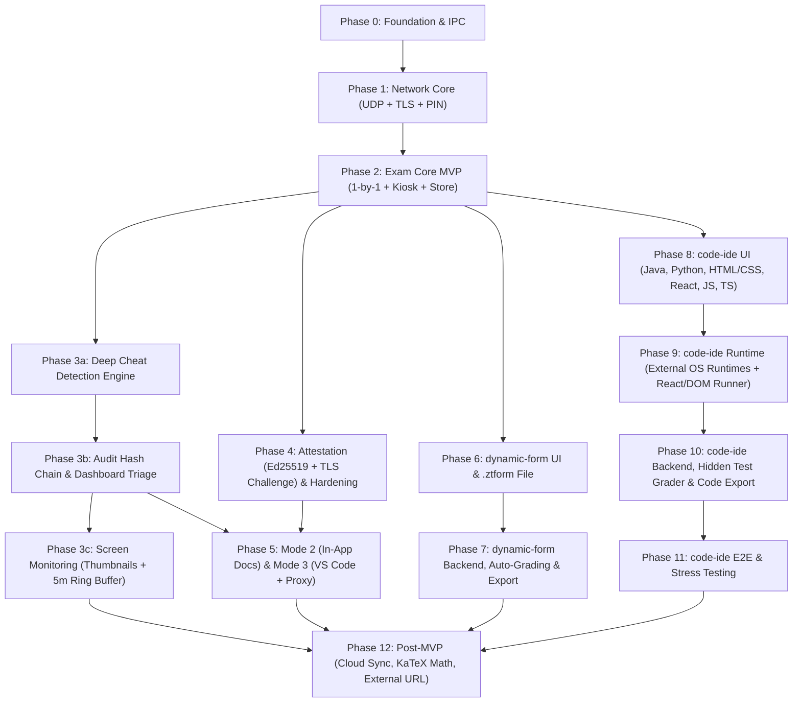

# ZT-Exam Master Roadmap & Implementation Plan

เอกสารชุดนี้แบ่งแผนการพัฒนาระบบ **ZT-Exam** ออกเป็น Phase ย่อยอย่างละเอียด โดยอ้างอิงจาก [project-arc.md](../project-arc.md) และ [tech-stack.md](../tech-stack.md)

---

## 1. สารบัญแผนงาน (Phase Index)

| ไฟล์ | Phase | เป้าหมายหลัก | สถานะ |
|---|---|---|---|
| [phase-0-foundation.md](./phase-0-foundation.md) | **Phase 0: Foundation & Scaffolding** | ตั้งโครงสร้างโปรเจกต์ `electron-vite`, TypeScript, React, Tailwind, IPC bridge ที่ปลอดภัย, SQLite, และหน้าเลือกบทบาท (Host / Student) | Done |
| [phase-1-network-core.md](./phase-1-network-core.md) | **Phase 1: Network Core & Protocol** | UDP Room Discovery, Ephemeral TLS 1.3 Server/Client, ยืนยันตัวตนเครื่องแม่ด้วย Room PIN, Framed Protocol (Zod), Heartbeat & Reconnect | Done |
| [phase-2-exam-core.md](./phase-2-exam-core.md) | **Phase 2: Exam Core (MVP - Mode 1)** | ระบบข้อสอบ Host-authoritative ส่งทีละข้อ, สลับลำดับข้อ/ตัวเลือกต่อคน, Watermark, Autosave, SQLite Encrypted Store, Kiosk UI พื้นฐาน | Pending |
| [phase-3a-cheat-detection.md](./phase-3a-cheat-detection.md) | **Phase 3a: Deep Cheat Detection Engine** | Signed Dynamic Policy, ตรวจจับโปรเซสที่เปลี่ยนชื่อไฟล์หนี (PE VersionInfo/Bundle ID), ดักโปรเซสเปิด-ปิดเร็วระดับมิลลิวินาที, ตรวจจับ Stealth Overlay (`WDA_EXCLUDEFROMCAPTURE`), ตรวจ OS DNS Cache, และดัก Synthetic Input (`LLKHF_INJECTED`) | Pending |
| [phase-3b-audit-and-triage.md](./phase-3b-audit-and-triage.md) | **Phase 3b: Audit Hash Chain & Dashboard Triage** | บันทึก Audit Log แบบ Cryptographic Hash Chain, คำนวณคะแนนความน่าสงสัยรวมกลุ่มเหตุการณ์ซ้ำ, และหน้าจอ Dashboard คัดกรองคนแดง (Triage) พร้อม Timeline หลักฐาน | Pending |
| [phase-3c-screen-monitoring.md](./phase-3c-screen-monitoring.md) | **Phase 3c: Screen Monitoring** | จับภาพทุกหน้าจอ, ส่ง Thumbnail ~1 fps, Ring Buffer เข้ารหัส 5 นาทีที่เครื่องนักเรียน (เซกเมนต์ละ 10 วินาที), Pin on Critical, Pull on Demand | Pending |
| [phase-4-attestation-hardening.md](./phase-4-attestation-hardening.md) | **Phase 4: Attestation, Native Guard & Hardening** | เซ็นไฟล์แอปด้วย Ed25519 Manifest, Challenge-Response ผูกกับ TLS Exporter ตลอดการสอบ, Native Addon (Keyboard Hook), Launch Guard & Electron Fuses | Pending |
| [phase-5-modes-2-3.md](./phase-5-modes-2-3.md) | **Phase 5: Exam Modes 2 & 3 (Docs & External Tools)** | Mode 2 (`WebContentsView` เอกสารในแอป + URL Whitelist) และ Mode 3 (Controlled VS Code Profile + Local HTTP CONNECT Proxy + Integrity Watchdog) | Pending |
| [phase-6-dynamic-form-builder.md](./phase-6-dynamic-form-builder.md) | **Phase 6: `dynamic-form` Module — Builder & `.ztform`** | ระบบสร้างฟอร์มแบบ Dynamic สไตล์ Google Forms รองรับ Input ครบ 12 ชนิด, ตั้งค่าเฉลยและคะแนนรายข้อ, และ Save/Load ฟอร์มเป็นไฟล์พกพา `.ztform` | Pending |
| [phase-7-form-backend-grading-export.md](./phase-7-form-backend-grading-export.md) | **Phase 7: `dynamic-form` Module — Backend, Grading & Export** | Backend ของระบบฟอร์มที่ฝังในตัวแอปเครื่องแม่ (Electron Main + SQLite), ตรวจเฉลยอัตโนมัติทันที, แก้เฉลยตรวจใหม่ทั้งห้อง (Re-grade All), และ Export คำตอบเป็น CSV/Excel หรือ `.ztresults` | Pending |
| [phase-8-code-ide-ui.md](./phase-8-code-ide-ui.md) | **Phase 8: `code-ide` Module — Multi-Language IDE UI** | หน้าจอ IDE ภายในแอป (Monaco Multi-file, Problem Builder, Test Console, และ Sandboxed Live Preview) รองรับ **Java, Python, HTML/CSS, React, JS, TS** และไฟล์ `.ztcode` | Pending |
| [phase-9-code-ide-runtime.md](./phase-9-code-ide-runtime.md) | **Phase 9: `code-ide` Module — External Runtime Engine** | เชื่อมต่อ Runtime ภายนอกในเครื่อง (`javac`/`java`, `python`, `node`) เหมือน IDE มาตรฐาน + Offline `esbuild`/React Bundler & Headless DOM Runner พร้อมระบบจำกัด Timeout/Memory | Pending |
| [phase-10-code-ide-backend.md](./phase-10-code-ide-backend.md) | **Phase 10: `code-ide` Module — Backend, Grader & Export** | Embedded Backend สำหรับตรวจ Hidden Test Cases (ทั้ง CLI และ DOM/React), คิวตรวจขนาน, หน้าดูโค้ด/Diff/Code Playback, และ Export คะแนน CSV + โฟลเดอร์ซอร์สโค้ด | Pending |
| [phase-11-code-ide-testing.md](./phase-11-code-ide-testing.md) | **Phase 11: `code-ide` Module — Testing & Stress Verification** | ชุดทดสอบครบทั้ง 6 ภาษา, ทดสอบตัดจบ Infinite Loop / Stdout Flood, ทดสอบจับโค้ดที่แอบยิงเน็ตหา AI, และทดสอบ End-to-End ในเครื่องเดียว | Pending |
| [phase-12-post-mvp.md](./phase-12-post-mvp.md) | **Phase 12: Post-MVP Extensions** | Cloud Sync หลังสอบ, สมการคณิตศาสตร์ออฟไลน์ (KaTeX), และ External URL Wrapper Mode | Pending |

---

## 2. ลำดับการพึ่งพา (Dependency Graph)

---

## 3. โครงสร้างแต่ละ Phase

ในแต่ละไฟล์ของ Phase จะประกอบด้วย:
1. **เป้าหมายและขอบเขต (Objectives & Scope)** – สิ่งที่ต้องทำให้เสร็จและสิ่งที่ยังไม่ทำใน Phase นั้น
2. **การแบ่งขั้นย่อย (Sub-phases / Step-by-Step Breakdown)** – แยกเป็นงานย่อย (`X.1`, `X.2`, ...) พร้อมระบุ:
   - ไฟล์ที่จะสร้างหรือแก้ไข (`src/main/...`, `src/renderer/...`)
   - โครงสร้างข้อมูล, Interfaces, Zod Schemas, หรือ SQLite Schema
   - ลำดับการทำงาน (Algorithm / Sequence / Edge Cases)
3. **Checklist งานย่อย (Implementation Checklist)** – รายการตรวจสอบสำหรับติดตามความคืบหน้า
4. **การทดสอบและเกณฑ์ผ่าน (Verification & Definition of Done)** – Unit test, Integration test, และขั้นตอนทดสอบจริง

---

## 4. กติการ่วมทุก Phase (Engineering Conventions)

1. **Process Isolation:**
   - Renderer ต้องรันด้วย `nodeIntegration: false`, `contextIsolation: true`, `sandbox: true` เสมอ
   - ทุก IPC channel ต้องมี Zod validation ที่ฝั่ง Main process ก่อนนำไปใช้งาน
2. **Host-Authoritative:**
   - ห้ามใช้เวลา (`Date.now()`) จากเครื่องนักเรียนเป็นเวลาอ้างอิงของข้อสอบหรือการหมดเวลา ให้ใช้เวลาของเครื่องแม่เท่านั้น
   - ห้ามส่งข้อมูลเฉลย หรือข้อสอบข้อที่ยังมาไม่ถึง ไปยังเครื่องนักเรียนเด็ดขาด
3. **Fail-Closed & Graceful Recovery:**
   - หากสัญญาณเครือข่ายหลุดชั่วคราว (เช่น สาย LAN ขยับ) ให้เข้าสู่สถานะ `FROZEN_DISCONNECTED` บนหน้าจอนักเรียน (ซ่อนโจทย์ข้อปัจจุบันชั่วคราว) และเมื่อต่อติดใหม่พร้อมผ่าน Attestation ให้กู้คืนข้อปัจจุบันและคำตอบที่ Autosave ไว้ทันที
4. **Cross-Platform Awareness:**
   - โค้ดที่พึ่งพาระบบปฏิบัติการ (เช่น Keyboard hook, Screen capture permissions, `setContentProtection`) ต้องผ่าน Adapter layer ที่แยกตาม `process.platform` (`win32`, `darwin`, `linux`) และมี fallback หรือรายงานสถานะให้เครื่องแม่ทราบเสมอ

