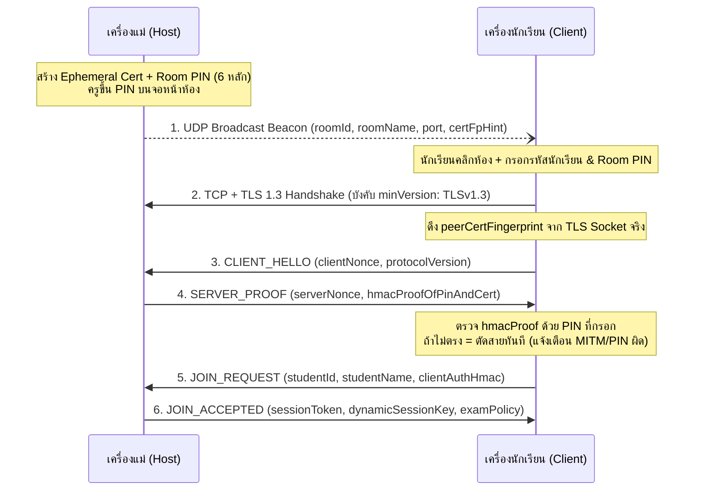

# Phase 1: Network Core, LAN Discovery & Authenticated TLS

## 1. เป้าหมายและขอบเขต (Objectives & Scope)
สร้างระบบสื่อสารผ่านเครือข่าย LAN แบบไม่ต้องตั้งค่า IP (Zero-configuration) สไตล์ Minecraft LAN โดยเครื่องแม่กระจายสัญญาณห้องสอบผ่าน **UDP Broadcast** และเครื่องนักเรียนเชื่อมต่อผ่าน **TCP + TLS 1.3** พร้อมใช้ **Room PIN** ยืนยันตัวตนเครื่องแม่เพื่อป้องกันการปลอมแปลงห้องสอบในวง LAN

### สิ่งที่ต้องได้เมื่อจบ Phase 1
- เครื่องแม่สร้างห้องสอบพร้อมสุ่ม TLS Certificate ชั่วคราวและ Room PIN 6 หลักได้
- เครื่องนักเรียนในวง LAN เดียวกันมองเห็นห้องสอบขึ้นในรายการอัตโนมัติ (และมีช่องกรอก IP:Port ด้วยตนเองเผื่อวง LAN บล็อก UDP Broadcast)
- การเชื่อมต่อ TLS 1.3 ตรวจสอบ Certificate Fingerprint คู่กับ Room PIN ก่อนอนุญาตให้ส่งข้อมูล
- ระบบ Framed Message Protocol (Length-prefixed + Zod validation) พร้อมระบบ Heartbeat และ Auto-reconnect

---

## 2. การแบ่งงานย่อย (Detailed Sub-phases)

### 1.1 Ephemeral TLS Certificate & Room PIN Cryptographic Binding (`src/main/network/crypto-cert.ts`)
1. **การสร้าง Self-Signed Certificate ต่อห้องสอบ:**
   - เมื่อครูเปิดห้องสอบ ให้สร้างคีย์คู่ใหม่ (ECDSA P-256 หรือ RSA 2048) และ X.509 Certificate ที่มีอายุสั้น (เช่น 12 ชั่วโมง) ในหน่วยความจำ
   - คำนวณ **Certificate Fingerprint:** `certFingerprint = SHA256(certDerBytes)` (รูปแบบ hex string 64 ตัวอักษร)
2. **การสร้าง Room PIN และยืนยันตัวตนเครื่องแม่:**
   - เครื่องแม่สุ่ม `roomPin` 6 หลัก (เช่น `482910`) แสดงตัวใหญ่บนหน้าจอครู/โปรเจกเตอร์ในห้องสอบ
   - เพื่อป้องกันคนในวง LAN ปล่อย UDP Beacon ปลอมพร้อม Cert ของตัวเอง:
     - เมื่อนักเรียนเชื่อมต่อ TLS สำเร็จ นักเรียนจะดึง `peerCertFingerprint` จาก TLS socket จริง (`tlsSocket.getPeerCertificate().fingerprint256`)
     - นักเรียนส่ง `HELLO_CHALLENGE` พร้อม `clientNonce` (32 bytes)
     - เครื่องแม่ตอบกลับด้วย `HELLO_PROOF = HMAC_SHA256(key = PBKDF2(roomPin, roomId, 10000), data = peerCertFingerprint + clientNonce + serverNonce)`
     - เครื่องนักเรียนคำนวณค่าเดียวกันจาก `roomPin` ที่นักเรียนพิมพ์เข้ามา ถ้าตรงกันจึงถือว่าเครื่องแม่เป็นของจริง
     - จากนั้นเครื่องนักเรียนส่ง `CLIENT_AUTH = HMAC_SHA256(key = PBKDF2(roomPin, roomId, 10000), data = peerCertFingerprint + serverNonce + clientNonce + studentId)` ให้เครื่องแม่ตรวจ



---

### 1.2 UDP Room Broadcaster & Discovery Listener (`src/main/network/discovery.ts`)
1. **Host UDP Broadcaster (`RoomBroadcaster`):**
   - ใช้ `dgram.createSocket({ type: 'udp4', reuseAddr: true })`
   - ตั้ง `socket.setBroadcast(true)`
   - ส่ง UDP packet ทุกๆ `2000 ms` ไปยัง broadcast address ของทุก network interface ที่เป็น IPv4 LAN (คำนวณ broadcast address จาก `os.networkInterfaces()` เช่น `192.168.1.255:44455` และ `255.255.255.255:44455`) **รวมถึงส่งเข้า `127.0.0.1:44455` เสมอ** เพื่อให้การรันเครื่องแม่และเครื่องลูกบนคอมพิวเตอร์เครื่องเดียวกันค้นหากันเจอทันทีแม้ไม่ได้เชื่อมต่อ Wi-Fi/LAN
   - โครงสร้าง UDP Beacon Payload (ขนาดเล็ก ไม่เกิน 512 bytes):
     ```ts
     const UdpBeaconSchema = z.object({
       magic: z.literal('ZTEXAM_V1'),
       roomId: z.string().uuid(),
       roomName: z.string().max(80),
       hostName: z.string().max(60),
       examMode: z.enum(['closed', 'in-app-docs', 'external-tools']),
       tcpPort: z.number().int().min(1024).max(65535),
       certFpShort: z.string().length(16), // 16 ตัวแรกของ SHA-256 fingerprint
       studentCount: z.number().int().nonnegative(),
       examStatus: z.enum(['lobby', 'in-progress', 'ended']),
       timestamp: z.number().int()
     })
     ```
2. **Client UDP Listener (`RoomDiscoveryListener`):**
   - เปิด socket ผูกพอร์ต `44455` (`reuseAddr: true`)
   - เมื่อได้รับ packet ให้ validate ด้วย `UdpBeaconSchema.safeParse`
   - เก็บรายการห้องลงใน Map (`roomId -> DiscoveredRoom`) พร้อม `lastSeenAt` และ `sourceIp` (`rinfo.address`)
   - มี Timer ลบห้องที่ไม่ได้ส่งสัญญาณเกิน `7000 ms` (Stale room cleanup) และแจ้ง Renderer ผ่าน IPC
3. **Manual IP Fallback:**
   - กรณี Router/Switch ของห้องแล็บบล็อก UDP broadcast ให้นักเรียนกรอก `Host IP` (หรือรหัสย่อของ IP เช่น `192.168.1.10:44456`) พร้อม Room PIN เพื่อเชื่อมต่อตรงผ่าน TCP/TLS ได้ทันที

---

### 1.3 Framed Binary/JSON Protocol over TLS (`src/main/network/protocol.ts`)
TCP เป็น stream protocol ข้อมูลอาจถูกตัดแบ่ง (fragmentation) หรือมาติดกันหลายข้อความ (concatenation) จึงต้องทำ **Length-Prefixed Framing**:

1. **Frame Structure:**
   - `[4 bytes: UInt32BE Payload Length][1 byte: Frame Type (0x01 = JSON, 0x02 = Binary Chunk)][N bytes: Payload]`
   - จำกัด `MAX_FRAME_SIZE = 10 * 1024 * 1024` (10 MB) ถ้าเกินให้ตัดการเชื่อมต่อทันทีเพื่อป้องกันการยิง packet ขยะจนหน่วยความจำเต็ม (DoS)
2. **Frame Parser (`FrameDecoder` Transform Stream):**
   - สะสม `Buffer` ใน queue จนกว่าจะมีอย่างน้อย 5 bytes
   - อ่าน `payloadLength` แล้วรอจนครบ `5 + payloadLength` bytes จึงตัดออกมาส่งเข้า `Zod` validator
3. **Message Envelope Schema (`src/shared/protocol-schema.ts`):**
   ```ts
   const BaseEnvelopeSchema = z.object({
     msgId: z.string().uuid(),
     seq: z.number().int().nonnegative(),
     timestamp: z.number().int(),
     type: z.string(),
     payload: z.unknown(),
     hmac: z.string().optional() // ใช้หลังได้รับ sessionKey แล้ว
   })
   ```
4. **Anti-Replay Sequence Tracking:**
   - ทั้งฝั่ง Host และ Client เก็บ `lastSentSeq` และ `lastReceivedSeq` ต่อการเชื่อมต่อ
   - ถ้า `incoming.seq <= lastReceivedSeq` ให้ปฏิเสธข้อความและบันทึกเป็น anomaly event

---

### 1.4 TLS 1.3 Server & Client Session Manager (`src/main/network/tls-server.ts` & `tls-client.ts`)
1. **Host TLS Server (`ExamTlsServer`):**
   - ใช้ `tls.createServer({ key, cert, minVersion: 'TLSv1.3', maxVersion: 'TLSv1.3' })`
   - ตั้ง ` handshakeTimeout: 5000` และจำกัดจำนวนการเชื่อมต่อจาก IP เดียวกันไม่เกินเกณฑ์ที่ตั้งไว้ (Rate limit ป้องกัน flood)
   - เมื่อผ่าน Handshake + PIN Verification แล้ว:
     - สร้าง `sessionToken` และ `dynamicSessionKey` (32 bytes) ประจำตัวนักเรียนคนนั้น
     - ผูก `studentId` เข้ากับ `ClientConnectionContext`
   - ดึงค่า **TLS Exporter Material** (`tlsSocket.exportKeyingMaterial(32, 'EXPORTER-ZT-EXAM-V1')`) เก็บไว้ใช้ผูกกับ Attestation ใน Phase 4
2. **Client TLS Connector (`ExamTlsClient`):**
   - ใช้ `tls.connect({ host, port, minVersion: 'TLSv1.3', rejectUnauthorized: false })` (ตั้ง `rejectUnauthorized: false` เฉพาะตอนเริ่มจับมือ เพราะเป็น Ephemeral Self-signed Cert แล้วตรวจความถูกต้องของ `peerCertFingerprint` คู่กับ `roomPin` ในขั้นตอน `SERVER_PROOF` แทน)
   - ดึง `tlsSocket.exportKeyingMaterial(32, 'EXPORTER-ZT-EXAM-V1')` เก็บไว้เช่นเดียวกัน

---

### 1.5 Heartbeat, Reconnection & Fail-Closed State Machine (`src/main/network/heartbeat.ts`)
1. **Heartbeat Loop:**
   - เครื่องนักเรียนส่ง `HEARTBEAT_PING` ทุกๆ `3000 ms` พร้อมสถานะย่อ (`currentQuestionIndex`, `focusState`, `activeMonitorMask`)
   - เครื่องแม่ตอบ `HEARTBEAT_PONG` พร้อมเวลาปัจจุบันของเครื่องแม่ (`serverTimeMs`, `remainingExamSeconds`)
2. **Timeout & Fail-Closed Handling:**
   - **ฝั่งเครื่องนักเรียน:** หากไม่ได้รับ `HEARTBEAT_PONG` หรือข้อมูลใดๆ จากเครื่องแม่เกิน `8000 ms`:
     - เปลี่ยนสถานะเป็น `DISCONNECTED_FROZEN`
     - แจ้ง Renderer ให้ขึ้นหน้าจอ Freeze บังข้อสอบทันที ("ขาดการติดต่อกับเครื่องแม่ กำลังเชื่อมต่อใหม่...")
     - พยายาม Reconnect อัตโนมัติด้วย Exponential Backoff (`1s -> 2s -> 4s`, สูงสุดทุก `5s`) โดยใช้ `sessionToken` เดิม
   - **ฝั่งเครื่องแม่:** หากไม่ได้รับ `HEARTBEAT_PING` จากนักเรียนเกิน `8000 ms`:
     - เปลี่ยนสถานะนักเรียนคนนั้นบน Dashboard เป็น `OFFLINE / DISCONNECTED` (สีเหลือง/แดง) และบันทึกลง Audit Log

---

## 3. Checklist งานย่อย (Implementation Checklist)

- [x] **1.1.1** สร้าง `crypto-cert.ts` สำหรับสุ่ม Ephemeral TLS Cert, Fingerprint และ Room PIN 6 หลัก (ECDSA P-256, อายุ 12 ชม.)
- [x] **1.1.2** สร้างฟังก์ชันคำนวณและตรวจสอบ `SERVER_PROOF` / `CLIENT_AUTH` ด้วย PBKDF2 + HMAC-SHA256 (timingSafeEqual เสมอ)
- [x] **1.2.1** สร้าง `RoomBroadcaster` ส่ง UDP beacon ทุก 2 วินาทีออกทุก LAN interface + `127.0.0.1` + `255.255.255.255`
- [x] **1.2.2** สร้าง `RoomDiscoveryListener` รับ UDP beacon, กรองด้วย Zod, และจัดการห้องที่หมดอายุ (7s stale cleanup) + Manual IP fallback ใน UI
- [x] **1.3.1** สร้าง `FrameEncoder` และ `FrameDecoder` (4-byte length prefix + max size guard 10 MB)
- [x] **1.3.2** กำหนด Zod schemas ของข้อความเครือข่ายใน `src/shared/protocol-schema.ts` (+ SecureConnection: anti-replay seq + HMAC ด้วย dynamicSessionKey)
- [x] **1.4.1** สร้าง `ExamTlsServer` รองรับ TLS 1.3, PIN handshake, Session management (RESUME_REQUEST), Rate limit ต่อ IP และดึง TLS Exporter
- [x] **1.4.2** สร้าง `ExamTlsClient` รองรับการเชื่อมต่อ TLS 1.3, ตรวจ `SERVER_PROOF`, และดึง TLS Exporter
- [x] **1.5.1** สร้างระบบ Heartbeat (3s ping / 8s timeout), Fail-closed freeze trigger (overlay ฝั่ง Student + status ฝั่ง Host), และ Auto-reconnect (backoff 1s→2s→4s→5s)
- [x] **1.6.1** สร้าง UI หน้า **Create Room (Host)** และ **Join Room / Room Browser (Student)** เพื่อทดสอบการค้นหาและเข้าห้องจริง

---

## 4. การทดสอบและเกณฑ์ผ่าน (Verification & Definition of Done)

1. **Automated Tests (`vitest`):**
   - **Frame Decoder Test:** ทดสอบส่งข้อมูลที่ถูกหั่นครึ่ง (partial chunks), ข้อมูลหลายเฟรมติดกันใน chunk เดียว, และเฟรมที่มีขนาดเกิน `MAX_FRAME_SIZE`
   - **TLS + PIN Handshake Integration Test:** รัน `ExamTlsServer` และ `ExamTlsClient` บน `127.0.0.1`:
     - กรณี PIN ถูกต้อง -> เชื่อมต่อสำเร็จ ได้ `sessionToken` และ `tlsExporter` ตรงกันทั้งสองฝั่ง
     - กรณี PIN ผิด -> Client และ Server ตัดการเชื่อมต่อทันที
     - กรณีจำลอง MITM (Server ใช้ Cert อื่นแต่ไม่รู้ PIN) -> Client ตรวจพบว่า `SERVER_PROOF` ไม่ตรงและตัดสายทันที
2. **Manual Verification:**
   - เปิดแอป 2 หน้าต่าง (Host 1, Student 1) -> Host เปิดห้อง -> Student เห็นห้องขึ้นในรายการภายใน 2 วินาที -> กรอก PIN ถูกแล้วเข้าห้อง Lobby ได้สำเร็จ
   - ลองกดจำลองสายหลุด/ปิดห้องชั่วคราว -> หน้าจอ Student ขึ้นสถานะ Freeze ภายใน 8 วินาที และต่อกลับได้เองเมื่อเปิดรับใหม่

