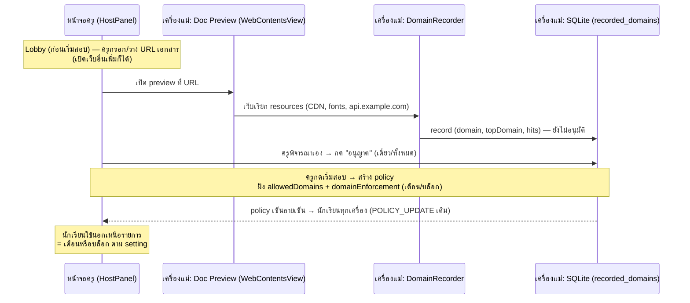

# Phase 3a-plus: Domain Recorder & Host-Authoritative Allowlist

> ต่อยอดจาก [phase-3a-cheat-detection.md](./phase-3a-cheat-detection.md) — แก้ปัญหา whitelist ที่ไม่รู้โดเมนย่อยล่วงหน้า

## 1. เป้าหมายและขอบเขต (Objectives & Scope)

### ปัญหา
ใน Mode 2 (In-App Docs) นักเรียนเปิดเว็บเอกสารผ่าน UI ของแอป หน้าเว็บหนึ่งมักเรียกโดเมนอื่น ๆ เพิ่มโดยที่ครูไม่รู้ล่วงหน้า เช่น CDN ของรูป, web fonts, API ของเว็บนั้น ถ้า whitelist มีแค่ URL ชั้นบนที่ครูกรอก ตัวตรวจจับ (DNS Cache Diffing และ Connection Monitor จาก Phase 3a) จะฟ้อง subresource เหล่านั้นจนเว็บใช้งานไม่ได้ หรือไม่ก็ต้องอนุญาตกว้างเกินไปจนเป็นช่องโหว่

### ทางแก้: ครูเปิดเองก่อนสอบ → ระบบ record โดเมนทั้งหมด → ครูอนุมัติ → อยู่ใน policy ตอนนักเรียนเข้า

**การบันทึกเกิดที่เครื่องแม่ล้วน ๆ** — ครูเปิดเว็บเอกสารด้วยหน้า "เตรียมเอกสาร" ของแอป (WebContentsView บนเครื่องครู) ระบบ hook ทุก request ที่หน้าเว็บเรียกจริง แล้วเก็บไว้ก่อน (ระหว่าง Lobby ก่อนกดเริ่มสอบ) นักเรียนไม่มีส่วนเกี่ยวกับการ record เลย:



### หลักการเดินหน้า (Non-negotiable)
1. **Host-authoritative 100%:** การบันทึก จัดเก็บ และตัดสินอนุมัติ อยู่ที่เครื่องแม่ทั้งหมด — เครื่องนักเรียนเป็นแค่ผู้รับ Signed Policy (โครงเดิม Phase 3a ใช้ได้เลย **ไม่ต้องเพิ่มข้อความ network ใหม่**)
2. **Allowlist คือกำแพง (default-deny):** นักเรียนเข้าเว็บได้ **เฉพาะโดเมนที่ record + อนุมัติแล้วเท่านั้น** — อะไรที่ไม่อยู่ในรายการ ถือว่าห้ามโดยปริยาย (ไม่ต้องมี blacklist ฝั่งเด็กเลย แค่ "ไม่ allow = ไม่ได้")
3. **ครูตรวจเอง ระบบไม่ตัดสินแทน:** ครูเปิดเว็บด้วยตัวเองแล้วพิจารณาเนื้อหาเองว่ามีสิ่งต้องห้ามหรือไม่ — ระบบไม่มีตัวขวางการอนุมัติ (ถ้าครูเห็นว่าโอเคกดอนุญาตทั้งหมดก็จบ) ระบบทำหน้าที่เพียง "บันทึกโดเมน + แสดงผลให้ตรวจง่าย" เท่านั้น
4. **พฤติกรรมเมื่อใช้นอกเหนือรายการ = setting ที่เลือกได้:** ต่อห้องสอบ เลือกได้ว่าเมื่อเว็บของนักเรียนพยายามเข้าโดเมนที่ไม่อนุมัติจะ **เตือน** (บันทึก + ฟ้องครู แต่ปล่อยผ่าน) หรือ **บล็อก** (ตัด request ทิ้ง + ฟ้อง)
5. **Record ก่อนเริ่มสอบ:** การเปิด preview ทำได้เฉพาะช่วง Lobby (`examStatus = lobby`) — ปิดตอนสอบกำลังรัน กันครูเผลอเปิดเว็บเสี่ยงระหว่างการคุมสอบ

### ขอบเขต
- **ครอบ:** หน้าเตรียมเอกสารของเครื่องแม่ (Doc Preview) + ที่เก็บ allowedDomains ต่อห้อง + UI อนุมัติ + การบังคับ (เตือน/บล็อก) ฝั่งนักเรียน
- **ไม่ครอบ:** network ของโปรเซสนอกเว็บวิวที่แอปคุม (ใช้ NetworkInspector เดิม), การ reuse รายการข้ามห้อง (ทำเป็น template ภายหลังได้ แต่ MVP ผูกต่อ session)

---

## 2. การแบ่งงานย่อย (Detailed Sub-phases)

### 3a-p.1 โครงสร้างฐานข้อมูลฝั่งเครื่องแม่ (`src/main/storage/migrations.ts`)
เพิ่ม **migration version 3**:

```sql
CREATE TABLE IF NOT EXISTS recorded_domains (
  session_id     TEXT NOT NULL REFERENCES exam_sessions(id),
  domain         TEXT NOT NULL,   -- hostname ที่ถูกเรียก (lowercase, ไม่รวม port)
  top_domain     TEXT NOT NULL,   -- hostname ของหน้าเว็บชั้นบนสุดที่เรียกมัน
  source         TEXT NOT NULL DEFAULT 'preview',  -- 'preview' | 'top-url'
  hits           INTEGER NOT NULL DEFAULT 1,
  first_seen_ms  INTEGER NOT NULL,
  last_seen_ms   INTEGER NOT NULL,
  approved       INTEGER NOT NULL DEFAULT 0,   -- 0 = รอครูตัดสิน, 1 = อนุมัติ
  approved_at_ms INTEGER,
  PRIMARY KEY (session_id, domain, top_domain)
);
CREATE INDEX IF NOT EXISTS idx_recorded_domains_session
  ON recorded_domains(session_id, approved);
```

- `hits` **สะสม** ทุกครั้งที่เห็นซ้ำ (บอกครูว่าเว็บพึ่งโดเมนนี้แค่ไหน — ตัดสินง่ายขึ้น)
- `source = 'top-url'` สำหรับโดเมนของ URL ชั้นบนที่ครูกรอก (auto-approved) / `'preview'` สำหรับ subresource ที่ hook เจอ
- ผูก `session_id` — อนุมัติต่อห้องสอบ ไม่แชร์ข้ามห้อง (กันของค้างจากห้องเก่า)

### 3a-p.2 ขยาย Policy Schema (`src/shared/policy-schema.ts`)
**ไม่ต้องเพิ่ม message type** — ใช้ `POLICY_UPDATE` + `allowedDomains` เดิมของ Phase 3a ทั้งหมด มี 2 การขยาย:

- ขยาย `DetectionPolicyBodySchema` เพิ่มฟิลด์:
  ```ts
  /** พฤติกรรมเมื่อเว็บของนักเรียนพยายามเข้าโดเมนที่ไม่อนุมัติ */
  domainEnforcement: z.enum(['warn', 'block']).default('warn')
  ```
  - `'warn'` (ค่าตั้งต้น): บันทึก event + ฟ้องครู แต่ปล่อยผ่าน — ห้องที่ครูยังเก็บรายการไม่ครบก็ยังใช้งานได้
  - `'block'`: ตัด request ทันที (นักเรียนเห็นหน้าปฏิเสธ) + ฟ้องครู — ทำงานได้จริงเพราะโดเมนถูกคุมที่ webRequest layer ของ WebContentsView ที่แอปคุม
- ค่าเริ่มต้นของ `domainEnforcement` สืบจากการตั้งค่า `enforcement` ของห้อง (report-only → `warn`, block-and-report → `block`) โดยครูตั้งทับได้ในการ์ดเตรียมเอกสาร

### 3a-p.3 DomainRecorder ฝั่งเครื่องแม่ (`src/main/host/domain-recorder.ts`)

```ts
export class DomainRecorder {
  attach(session: Electron.Session, getTopUrl: () => string | null): void
  detach(): void   // flush รายการค้างก่อนถอด
}
```

- **จับ:** `session.webRequest.onBeforeRequest` — ดึง `hostname` จาก URL ของทุก request (main frame + subresources + fetch/XHR) → normalize: lowercase, ตัด port, แปลง punycode เป็น unicode
- **กรองทิ้ง (ไม่ record):** `localhost` / `127.0.0.1` / IP ของเครื่องแม่เอง / scheme `data:`, `blob:`, `devtools:` — กัน noise จากตัวแอป
- **dedupe + นับ hits** ในหน่วยความจำต่อ `(domain, topDomain)` แล้ว flush ลง SQLite ทุก 3 วินาที (ตัวเดียว ไม่มี network เกี่ยว)
- **IP literal:** เก็บเป็น `"IP:1.2.3.4"` — แสดงใน UI แยกหมวดให้ครูระวังตัดสิน (เว็บที่ hardcode IP มักไม่น่าเชื่อถือสำหรับเอกสารสอบ)
- **สองโหมดของ hook เดียวกัน (เลือกตอน attach):**
  - **โหมด record (ครูเปิดเอง):** ปล่อยทุก request ผ่านหมด — จำเป็น เพราะต้องให้เว็บโหลดครบเพื่อบันทึกให้ครบ
  - **โหมด enforce (นักเรียนใช้งานจริง — ร่วมกับ WebContentsView ของ Mode 2 ใน [phase-5-modes-2-3.md](./phase-5-modes-2-3.md)):** ตรวจทุก request กับรายการอนุมัติ:
    - อยู่ใน allowed (exact/subdomain) → ปล่อยผ่าน
    - ไม่อยู่ใน allowed → `warn` = ปล่อยผ่าน + event / `block` = `{ cancel: true }` + event **`UNAUTHORIZED_DOMAIN_DETECTED`** (เพิ่มใน Detection Event Catalog คะแนน 25 — เด็กจะเห็นหน้าจอ "โดเมนนี้ไม่ได้รับอนุญาตในห้องสอบนี้")
- ผูกกับ WebContentsView ตัวเดียวกันที่ใช้ในหน้า Doc Preview (reuse กับ Mode 2 ของ Phase 5)

### 3a-p.4 Host Pipeline (`src/main/host/core-session-manager.ts` + service ใหม่ `src/main/host/domain-allowlist.ts`)

1. **Doc Preview controller:** IPC `host:open-doc-preview { url }` — ตรวจว่า `examStatus = lobby` และ Mode 2 → เปิด WebContentsView (attach ในโหมด record) + ปุ่ม "เปิดเว็บอื่นเพื่อ record เพิ่ม" ได้ (ครูเปิดกี่เว็บก็ได้ โดเมนรวมกันในรายการเดียวต่อห้อง); ปิด preview → `detach()` + flush
2. **DomainAllowlistService** (ครอบ DB):
   - `recordBatch(records)`: upsert (hits สะสม, first/last_seen)
   - `list(sessionId)`: รายการทั้งหมดเรียง hits มาก→น้อย พร้อมสถานะ
   - `approve(domain | 'all', approved)`: อนุมัติรายการเดียวหรือทั้งหมดที่ค้าง — **ไม่มีตัวขวาง** (ครูตรวจเองแล้ว) แค่ emit audit-ready log `DOMAIN_APPROVED_<domain>` / `DOMAIN_REVOKED_<domain>`
   - ป้ายเตือนเชิงข้อมูล: รายการที่ชน `forbiddenDomains` แสดง badge สีแดงให้ครูสังเกต (ไม่ห้ามกด)
3. **ผูกตอนเริ่มสอบ:** `startExam()` โหลดโดเมน `approved = 1` ของ session ใส่ `policyBody.allowedDomains` + ตั้ง `domainEnforcement` ตาม setting ก่อนเซ็นและกระจาย (โครง `buildDefaultPolicy` + `signPolicy` เดิม)
4. **อนุมัติเพิ่มกลางสอบ (ยินยอมให้ทำได้):** ครูกดอนุญาตรายการที่ค้างไว้จากตอน preview → `version += 1` → เซ็นใหม่รายคน → `POLICY_UPDATE` ไปทุกเครื่องออนไลน์ทันที (กลไก push จาก Phase 3a ใช้ซ้ำ)

### 3a-p.5 IPC Surface & Host UI (`src/shared/ipc-channels.ts`, `src/renderer/src/components/HostPanel.tsx`)

**IPC เพิ่ม:**
| ช่อง | ทิศทาง | payload |
|---|---|---|
| `host:open-doc-preview` | invoke | req: `{ url: string }` → res: `{ ok, reason? }` (เฉพาะ lobby + Mode 2) |
| `host:close-doc-preview` | invoke | req: void → res: `{ ok }` |
| `host:list-recorded-domains` | invoke | req: void → res: `{ records: Array<{ domain, topDomain, hits, source, approved, lastSeenAtMs }> }` |
| `host:approve-domain` | invoke | req: `{ domain: string, approved: boolean }` → res: `{ ok, reason? }` |
| `host:recorded-domains-updated` | event (main → renderer) | `{ records: [...] }` (push หลัง flush ทุกรอบ) |

**UI ใน HostPanel (การ์ด "เตรียมเอกสาร & โดเมนที่อนุญาต" — โชว์เมื่อ Mode 2):**
- ช่องวาง URL + ปุ่ม "เปิดตรวจเอกสาร" (เฉพาะ lobby) → เปิดหน้าต่าง preview ให้ครูใช้งานเหมือนเบราว์เซอร์ปกติ (ไปหน้าอื่น/เปิดเว็บอื่นก็ได้ — โดเมนใหม่ถูก record รวมต่อ)
- **Setting การบังคับ (toggle ในการ์ด):** "เมื่อนักเรียนใช้โดเมนนอกเหนือรายการ → `เตือน (แจ้งครู)` / `บล็อก (ตัดทันที)`" — ค่าเริ่มต้นสืบจาก enforcement ของห้อง
- รายการโดเมนที่ record ได้: `domain · topDomain · hits ครั้ง` + ป้าย (รอตัดสิน / อนุญาตแล้ว / โดเมนหลัก) + ปุ่มอนุญาต/ยกเลิก
- Badge จำนวนที่ยังไม่ตัดสิน + ปุ่ม "อนุญาตทั้งหมด" (ครูตรวจแล้วเชื่อมั่นรายการครบ)
- Badge ข้อมูลสีแดงเฉย ๆ สำหรับรายการที่ชื่อชนโดเมน AI ที่รู้จัก (ให้ครูสังเกตเอง — ระบบไม่ขวาง)

### 3a-p.6 ผนวกกับตัวตรวจจับเดิม (`src/main/guard/network-inspector.ts`)

- เพิ่มรหัสเหตุการณ์ **`UNAUTHORIZED_DOMAIN_DETECTED`** ใน Detection Event Catalog (คะแนน `+25`) — ใช้ทั้งที่ webRequest layer (โดเมนไม่อยู่ใน allowed) และ DNS layer (DNS cache เจอโดเมนไม่ allowed ระหว่างสอบ)
- `matchForbiddenDomain` เดิมปรับเป็น **ตรวจกับ allowedDomains เป็นหลัก**: โดเมนที่อนุมัติแล้ว (รวม subdomain ลูก) ไม่ฟ้อง — โดเมนที่ไม่อนุมัติ → ฟ้องตาม `domainEnforcement` (บล็อกที่ webRequest layer ได้เฉพาะเว็บใน WebContentsView ที่แอปคุม / DNS layer เป็นการเตือนคู่ขนาน)
- **ข้อจำกัดที่ยอมรับ:** การบล็อกจริง (cancel request) ทำได้เฉพาะเว็บที่เปิดผ่าน UI ของแอป — โปรเซสอื่นที่ออกเน็ตตรงยังตรวจด้วย NetworkInspector เดิม (ฟ้อง ไม่บล็อก)

---

## 3. Checklist งานย่อย (Implementation Checklist)

- [x] **3a-p.1** Migration v3 ตาราง `recorded_domains` (ผูก session_id, source, approved flag, ดัชนีต่อ session)
- [x] **3a-p.2** ฟิลด์ `domainEnforcement: 'warn' | 'block'` ใน `DetectionPolicyBodySchema` (ไม่ต้องเพิ่ม network message)
- [x] **3a-p.3** `DomainRecorder` (attach สองโหมด record/enforce, webRequest hook, normalize, dedupe+hits, flush ลง DB ทุก 3s, block ด้วย cancel)
- [x] **3a-p.4** `DomainAllowlistService` (recordBatch/list/approve-ทั้งหมด) + Doc Preview controller (lobby เท่านั้น) + ผูก `startExam` โหลด approved เข้า policy + push กลางสอบเมื่ออนุมัติเพิ่ม
- [x] **3a-p.5** IPC (`host:open-doc-preview`, `host:close-doc-preview`, `host:list-recorded-domains`, `host:approve-domain`, event `host:recorded-domains-updated`) + การ์ด UI ใน HostPanel (รวม setting เตือน/บล็อก)
- [x] **3a-p.6** เพิ่ม event `UNAUTHORIZED_DOMAIN_DETECTED` + ผนวก allowedDomains กับ NetworkInspector DNS diff + ใช้ WebContentsView ตัวเดียวกันกับ Mode 2 (ร่วมแผน Phase 5)

## 4. การทดสอบและเกณฑ์ผ่าน (Verification & Definition of Done)

1. **Automated Tests (`vitest`):**
   - **Recorder Test:** จำลอง webRequest events 30 requests ข้าม 3 โดเมน (ปน localhost) → flush ได้ 3 records, hits รวมถูกต้อง, localhost หาย
   - **Upsert Test:** record โดเมนเดิมซ้ำ 2 รอบ → 1 แถวแต่ `hits` สะสม + `last_seen_ms` อัปเดต
   - **Approve Flow Test:** กดอนุญาต `cdn.example.com` (และ "อนุญาตทั้งหมด") → policy `version+1`, `allowedDomains` มีรายการ, นักเรียนออนไลน์ทุกเครื่องได้รับ `POLICY_UPDATE` ที่ตรวจลายเซ็นผ่าน (คีย์รายคน)
   - **Enforce-warn Test:** `domainEnforcement = 'warn'` + นักเรียนเรียกโดเมนที่ไม่ allowed → ปล่อยผ่าน + event `UNAUTHORIZED_DOMAIN_DETECTED`
   - **Enforce-block Test:** `domainEnforcement = 'block'` + นักเรียนเรียกโดเมนที่ไม่ allowed → request ถูก `cancel` + event พร้อมหน้าปฏิเสธ; โดเมนที่ allowed ต้องผ่านปกติ
   - **Lobby-only Guard Test:** ขอเปิด preview ตอน `examStatus = running` → ปฏิเสธ
   - **DNS Diff Test:** โดเมนที่อนุมัติ (รวม subdomain ลูก) ไม่ฟ้อง / โดเมนที่ไม่อนุมัติฟ้องตาม `domainEnforcement`
2. **Manual Verification:**
   - ครูสร้างห้อง Mode 2 → วาง URL เอกสาร กดเปิดตรวจ (เปิดเว็บอื่นเพิ่มก็ได้) → กลับมาหน้าครูเห็นโดเมนย่อย (CDN/fonts) พร้อม hits → กด "อนุญาตทั้งหมด" → เริ่มสอบ → นักเรียนเปิดเว็บเดิมผ่าน UI ใช้งานได้ครบ
   - ตั้ง `block` แล้วให้นักเรียน (หรือเว็บ) พยายามเรียกโดเมนที่ไม่ allow → หน้าเว็บโหลดไม่ขึ้น (ถูกตัด) และหน้าครูขึ้น `UNAUTHORIZED_DOMAIN_DETECTED` ทันที สลับเป็น `warn` → โหลดขึ้นแต่ครูยังได้รับแจ้ง
   - ครูอนุมัติเพิ่มกลางสอบ → เครื่องนักเรียนได้ policy ใหม่ภายในไม่กี่วินาที (ไม่ต้อง reconnect)
   - ปิดแอปนักเรียน/เปิดใหม่ (reconnect) → ได้ policy ที่มีรายการอนุมัติครบจาก DB
