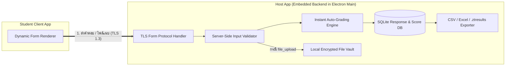

# Phase 7: Embedded Form Backend, Auto-Grading Engine & Response Export

## 1. เป้าหมายและขอบเขต (Objectives & Scope)
สร้าง **Backend ของระบบฟอร์มที่ฝังอยู่ในตัวแอปเดิม (Embedded inside Electron Main Process + SQLite)** โดยไม่ต้องรันเซิร์ฟเวอร์แยกต่างหาก ทำหน้าที่รับคำตอบและไฟล์แนบจากเครื่องนักเรียนผ่านท่อ LAN TLS ตรวจสอบความถูกต้องของข้อมูลตามกฎของฟอร์มแต่ละข้อ (**Server-Side Form Validation**) **ตรวจเฉลยและคำนวณคะแนนทันที (Instant Auto-Grading)** รองรับการแก้ไขเฉลยย้อนหลังแล้วคำนวณคะแนนใหม่ทั้งห้อง (Re-grade All) และ **ส่งออกคำตอบทั้งหมดเป็นไฟล์ Excel/CSV หรือชุดรายงานผลสอบ (`.ztresults`)**

### สิ่งที่ต้องได้เมื่อจบ Phase 7
- **Embedded Form Backend** ภายใน Electron Main Process ของเครื่องแม่ จัดการวงจรชีวิตของฟอร์ม คำตอบ และไฟล์อัปโหลดของนักเรียนทั้งหมดในตัวแอปเดียว
- **Auto-Grading Engine** ที่ตรวจคำตอบอัตโนมัติได้ทันทีสำหรับทุก Input ที่มีเฉลย (รวมถึงการคิดคะแนนบางส่วนของ Checkboxes, ตาราง Grid, และสูตรคำนวณตัวแปรสุ่ม)
- หน้าจอ **Live Grading & Manual Review** บนเครื่องแม่: ดูคะแนนที่ตรวจอัตโนมัติได้ทันที ให้คะแนนข้ออัตนัย/โค้ด/ไฟล์แนบเพิ่มเติม และปรับแก้เฉลยเพื่อสั่งตรวจใหม่ทั้งห้องได้ในคลิกเดียว
- ระบบ **Export คำตอบและผลคะแนน**: ส่งออกเป็นไฟล์ `.csv` (รองรับภาษาไทยใน Excel 100%), รายงานสรุปรายคน/รายข้อ, และไฟล์เก็บผลสอบ `.ztresults`

---

## 2. การแบ่งงานย่อย (Detailed Sub-phases)

### 7.1 Embedded Form Backend Architecture (`src/main/host/form-backend/`)
Backend ทั้งหมดทำงานอยู่ภายในโปรเซสหลัก (`Main Process`) ของแอปฝั่งเครื่องแม่ (Host) โดยใช้ฐานข้อมูล SQLite (`better-sqlite3`) และระบบไฟล์ในเครื่องแม่ ไม่ต้องตั้งค่า Web Server หรือ Database Server แยกต่างหาก:

1. **Server-Side Dynamic Input Validator (`src/main/host/form-backend/validator.ts`):**
   - เมื่อเครื่องนักเรียนส่งคำตอบของข้อใดเข้ามา (`SUBMIT_FORM_ITEM` หรือ `AUTOSAVE_FORM_ITEM`):
   - ดึง `FormValidationRule` ของข้อนั้นขึ้นมาตรวจสอบที่ฝั่งเครื่องแม่อีกครั้งเสมอ (ไม่เชื่อการตรวจจากฝั่ง UI อย่างเดียว):
     - `mcq_single` / `dropdown`: ตรวจว่า `choiceId` ที่ส่งมามีอยู่จริงในตัวเลือกของข้อนั้น
     - `checkbox_multi`: ตรวจว่าจำนวนตัวเลือกที่ส่งมาอยู่ในเกณฑ์ `minSelect <= count <= maxSelect` และทุก `choiceId` มีอยู่จริง
     - `short_text` / `long_text` / `code_snippet`: ตรวจ `minLength`, `maxLength`, และ `regexPattern`
     - `numeric_param` / `linear_scale`: ตรวจว่าเป็นตัวเลขจริง (`Number.isFinite`) และอยู่ในช่วง `numericMin .. numericMax`
     - `mcq_grid` / `checkbox_grid`: ตรวจว่าครบทุก `rowId` ที่บังคับตอบ และ `columnId` ถูกต้อง
2. **Embedded File Upload Vault สำหรับข้อชนิด `file_upload` (`src/main/host/form-backend/file-vault.ts`):**
   - เมื่อนักเรียนอัปโหลดไฟล์คำตอบ (เช่น `solution.py` หรือ `diagram.png`):
   - แบ่งส่งเป็น Chunk ผ่านท่อ TLS (`FILE_UPLOAD_CHUNK`) พร้อมตรวจนามสกุลไฟล์ ขนาดไฟล์สูงสุด และคำนวณ `SHA-256`
   - เครื่องแม่เข้ารหัสไฟล์ด้วย `AES-256-GCM` แล้วเก็บไว้ที่ `userData/exam-vault/<roomId>/<studentId>/<questionId>_<safeFilename>.enc` พร้อมบันทึกข้อมูลลงตาราง `uploaded_artifacts`

---

### 7.2 Instant Auto-Grading & Formula Evaluation Engine (`src/main/host/form-backend/grader.ts`)
ทันทีที่ได้รับคำตอบของแต่ละข้อ ตัว `AutoGrader` จะตรวจเทียบกับ `AnswerKey` ของข้อนั้นและบันทึกคะแนนลงฐานข้อมูลทันที:

1. **กฎการคำนวณคะแนนตามชนิด Input:**
   - **`mcq_single` & `dropdown` (`exact_choice`):**
     - ถ้า `answer.choiceId === key.correctChoiceId` -> ได้ `question.points` เต็ม (หรือดึงคะแนนจาก `key.choiceWeights[answer.choiceId]` หากครูตั้งคะแนนลดหลั่นตามตัวเลือก)
   - **`checkbox_multi` (`multi_choice`):**
     - ให้ $C$ คือเซตของตัวเลือกที่ถูกต้องทั้งหมด และ $S$ คือเซตของตัวเลือกที่นักเรียนเลือก:
     - **โหมด `all-or-nothing`:** ถ้า $S = C$ เป๊ะ ได้คะแนนเต็ม นอกนั้นได้ `0`
     - **โหมด `partial-with-penalty`:**
       $$\text{Score} = \max\left(0,\; \left(\frac{|S \cap C|}{|C|} - \frac{|S \setminus C| \times \text{penaltyRatio}}{|C|}\right) \times \text{points}\right)$$
       *(ป้องกันไม่ให้นักเรียนติ๊กมั่วทุกช่องเพื่อให้ได้คะแนนฟรี)*
   - **`short_text` (`short_text_match`):**
     - ทำความสะอาดข้อความตามการตั้งค่า (`trim()`, แปลงช่องว่างซ้ำเป็นช่องว่างเดียว, แปลงตัวพิมพ์เล็กหาก `caseSensitive: false`)
     - เทียบกับรายการ `acceptedAnswers[]` ทั้งหมด (หรือเทียบด้วย `RegExp` หากเปิด `useRegex: true`) ถ้าตรงกับคำตอบใดคำตอบหนึ่ง ได้คะแนนเต็มทันที
   - **`numeric_param` (`numeric_formula`):**
     - ดึงค่าตัวแปรสุ่มประจำตัวนักเรียนคนนั้นของข้อนั้น (เช่น `{ a: 12, b: 5 }`)
     - คำนวณค่าเฉลยจริง `expectedValue` ด้วย **Safe Math Expression Evaluator** (Parser ทางคณิตศาสตร์ที่รองรับ `+`, `-`, `*`, `/`, `^`, `sqrt`, `sin`, `cos`, `abs`, `round`, `ln` โดย **ห้ามใช้ `eval()` ของ JavaScript เด็ดขาด**!)
     - ถ้า $| \text{studentNumber} - \text{expectedValue} | \le \text{key.tolerance}$ -> ได้คะแนนเต็ม
   - **`mcq_grid` & `checkbox_grid` (`grid_match`):**
     - ตรวจแยกทีละแถว (`rowId`) แถวที่ตอบถูกได้ `pointsPerRow` แล้วรวมเป็นคะแนนของข้อนั้น
   - **`long_text`, `code_snippet`, `file_upload` (`manual_rubric`):**
     - ตั้งสถานะการตรวจเป็น `NEEDS_MANUAL_REVIEW`
     - หากครูระบุ `expectedKeywords[]` ไว้ ระบบจะสแกนหาคำสำคัญในคำตอบและแสดงเป็นป้ายช่วยตรวจให้ครูเห็น (เช่น `"พบ Keyword 4/5 คำ: encapsulation, inheritance, polymorphism, abstraction"`)

2. **ระบบแก้ไขเฉลยและสั่งตรวจใหม่ทั้งห้อง (`Re-grade All Submissions`):**
   - บ่อยครั้งหลังสอบเสร็จ ครูอาจพบว่าโจทย์ข้อที่ 7 พิมพ์ตัวเลขผิด หรือควรยอมรับคำตอบได้มากกว่า 1 ข้อ:
   - ครูสามารถเปิดแก้ `AnswerKey` ของข้อนั้นบนหน้าผลสอบ แล้วกดปุ่ม **"🔄 คำนวณคะแนนใหม่ทั้งห้อง (Re-grade All)"**
   - ระบบจะดึงคำตอบดิบของนักเรียนทุกคนในห้องมาวิ่งผ่าน `AutoGrader` ใหม่ภายในเสี้ยววินาที พร้อมบันทึกประวัติการปรับเกณฑ์คะแนนลงใน Audit Log

---

### 7.3 Teacher Grading, Response Table & Analytics UI (`src/renderer/src/host/responses/`)
ออกแบบให้มีหน้าตาและการใช้งานเหมือนแท็บ **"การตอบกลับ (Responses)"** ใน Google Forms แต่ทรงพลังกว่าด้วยข้อมูลความปลอดภัย:

1. **มุมมองที่ 1: สรุปภาพรวมและสถิติ (`Summary & Item Analysis Tab`):**
   - แสดงคะแนนเฉลี่ย (Mean), มัธยฐาน (Median), คะแนนสูงสุด/ต่ำสุด, และกราฟแท่งการกระจายคะแนน
   - แสดงสถิติรายข้อ (Question Breakdown): ข้อไหนที่นักเรียนตอบผิดเกิน 70% จะแสดงป้ายเตือนเพื่อให้ครูตรวจสอบว่าโจทย์กำกวมหรือไม่
2. **มุมมองที่ 2: ตรวจรายข้อ (`By Question Grading Tab` — เร็วที่สุดสำหรับตรวจข้ออัตนัย):**
   - เลือกข้อสอบที่ต้องการตรวจ (เช่น ข้อที่ 15 อัตนัย) -> หน้าจอจะแสดงคำตอบเฉพาะข้อที่ 15 ของนักเรียนทุกคนเรียงลงมา (มีปุ่มซ่อนชื่อนักเรียนชั่วคราว `Blind Grading` เพื่อความยุติธรรม)
   - ครูคลิกให้คะแนนตามเกณฑ์ Rubric หรือพิมพ์คะแนนแล้วกด `Enter` เพื่อเลื่อนไปตรวจคนถัดไปได้ทันที
3. **มุมมองที่ 3: ดูใบคำตอบรายบุคคล (`Individual Student Sheet Tab`):**
   - เลือกชื่อนักเรียน -> เห็นใบข้อสอบทั้งชุดของนักเรียนคนนั้น (พร้อมค่าตัวแปรสุ่มที่นักเรียนคนนั้นได้รับ), คำตอบที่ตอบ, เฉลยที่ถูกต้อง, เวลาที่ใช้ทำในแต่ละข้อ, และสรุปสถานะความปลอดภัยจาก Phase 3b

---

### 7.4 Response Export Engine (Excel CSV, Printable Sheets & `.ztresults`) (`src/main/host/form-backend/exporter.ts`)
1. **การส่งออกเป็นไฟล์ Excel / CSV (`.csv` with UTF-8 BOM):**
   - ใส่ไบต์ `0xEF, 0xBB, 0xBF` (UTF-8 BOM) ที่ต้นไฟล์เสมอ เพื่อให้เปิดในโปรแกรม **Microsoft Excel** บน Windows แล้วภาษาไทยไม่เพี้ยน 100%
   - โครงสร้างตารางเหมือน Google Forms แต่ละเอียดกว่า:
     - คอลัมน์มาตรฐาน: `ลำดับ`, `รหัสนักเรียน`, `ชื่อ-นามสกุล`, `เวลาเริ่มทำ`, `เวลาส่งข้อสอบ`, `คะแนนที่ได้`, `คะแนนเต็ม`, `คิดเป็น %`, `สถานะการตรวจ (ตรวจครบ/รอตรวจอัตนัย)`, `สถานะความปลอดภัย (NORMAL/WARNING/CRITICAL)`, `คะแนนความน่าสงสัย`, `จำนวนเหตุการณ์วิกฤต`, `หมายเหตุผู้คุมสอบ`
     - คอลัมน์รายข้อ (เรียงตามลำดับข้อมาตรฐานของฟอร์ม แม้ตอนสอบจะสลับลำดับข้อรายคน ระบบจะจัดเรียงกลับมาให้ตรงคอลัมน์ข้อที่ 1, 2, 3 เสมอ!):
       - `Q1: [ชื่อโจทย์ย่อ] (คำตอบ)` | `Q1 (คะแนน)` | `Q2: [ชื่อโจทย์ย่อ] (คำตอบ)` | `Q2 (คะแนน)` ...
2. **การส่งออกไฟล์เก็บผลสอบครบชุด (`.ztresults` Archive):**
   - บันทึกทั้งชุดฟอร์ม (`.ztform`), คำตอบของนักเรียนทุกคน, ไฟล์ที่นักเรียนอัปโหลดในข้อ `file_upload`, คะแนนที่ตรวจแล้ว, และ `AuditLog` Hash Chain ลงเป็นไฟล์ `.ztresults` ไฟล์เดียว (เข้ารหัสได้)
   - ครูสามารถก๊อปปี้ไฟล์ `.ztresults` จากเครื่องแม่ในห้องแล็บ กลับมาเปิดตรวจข้ออัตนัยต่อที่บ้านบนโน้ตบุ๊กส่วนตัว และกด Export เป็น CSV ที่บ้านได้ทุกเมื่อ!

---

## 3. Checklist งานย่อย (Implementation Checklist)

- [x] **7.1.1** สร้าง `FormValidator` ใน Electron Main ตรวจสอบคำตอบทุกชนิดเทียบกับ `FormValidationRuleSchema`
- [x] **7.1.2** สร้าง `FileVault` สำหรับรับและเข้ารหัสไฟล์อัปโหลดของข้อสอบชนิด `file_upload` ผ่านท่อ TLS
- [x] **7.2.1** สร้าง `SafeMathEvaluator` (ไม่ใช้ `eval`) สำหรับคำนวณสูตรเฉลยของข้อสอบชนิด `numeric_param`
- [x] **7.2.2** สร้าง `AutoGrader` ตรวจให้คะแนนอัตโนมัติครบทุกชนิด Input (`exact_choice`, `multi_choice`, `short_text_match`, `numeric_formula`, `grid_match`)
- [x] **7.2.3** สร้างฟีเจอร์ `regradeAllSubmissions(roomId, updatedFormDefinition)` สำหรับคำนวณคะแนนใหม่ทั้งห้องเมื่อครูแก้เฉลย
- [x] **7.3.1** สร้างหน้าจอ `ResponsesDashboard.tsx` แบ่ง 3 แท็บ: `Summary`, `By Question (Fast Manual Grading)`, และ `Individual Student`
- [x] **7.4.1** สร้าง `CsvResponseExporter` ที่จัดเรียงคำตอบที่เคยถูกสลับลำดับรายคน กลับมาเรียงตามคอลัมน์ข้อมาตรฐาน `Q1..QN` พร้อมใส่ UTF-8 BOM
- [x] **7.4.2** สร้างระบบ Save / Open ไฟล์ `.ztresults` เพื่อให้ครูนำผลสอบกลับไปตรวจต่อหรือเปิดดูย้อนหลังได้

---

## 4. การทดสอบและเกณฑ์ผ่าน (Verification & Definition of Done)

1. **Automated Tests (`vitest`):**
   - **Auto-Grading Accuracy Test:**
     - ทดสอบ `checkbox_multi` โหมด `partial-with-penalty`: ถ้ามีตัวเลือกที่ถูก 2 ข้อ นักเรียนเลือกถูก 2 ข้อแต่เลือกข้อผิดติดมา 1 ข้อ ต้องถูกหักคะแนนตามสัดส่วนและไม่ติดลบต่ำกว่า 0
     - ทดสอบ `numeric_formula`: โจทย์ `a * b + c` เมื่อนักเรียน A ได้ `{a: 3, b: 4, c: 2}` (เฉลย `14`) และนักเรียน B ได้ `{a: 5, b: 6, c: 1}` (เฉลย `31`) ต้องตรวจให้คะแนนตามค่าตัวแปรของแต่ละคนได้อย่างแม่นยำ
   - **Shuffled-to-Canonical CSV Export Test:** นักเรียน 3 คนที่ได้ลำดับข้อสอบสลับกันคนละแบบ เมื่อส่งออกเป็นไฟล์ CSV คำตอบของแต่ละคนต้องถูกวางลงในคอลัมน์ `Q1`, `Q2`, `Q3` ที่ตรงกับข้อจริงของฟอร์ม 100%
2. **Manual Verification:**
   - ทดสอบทำข้อสอบที่มีครบทุกชนิด Input จากเครื่องนักเรียน -> เมื่อกดส่ง บนหน้าจอครูต้องเห็นคะแนนข้อปรนัย/เติมคำสั้น/ตาราง Grid ขึ้นทันที
   - ทดสอบให้ครูแก้เฉลยของข้อที่ 1 แล้วกด `Re-grade All` -> คะแนนของนักเรียนทุกคนในตารางต้องอัปเดตใหม่ทันที
   - ทดสอบกด Export CSV แล้วเปิดในโปรแกรม Microsoft Excel -> ภาษาไทยต้องแสดงผลถูกต้องและข้อมูลครบทุกคอลัมน์

