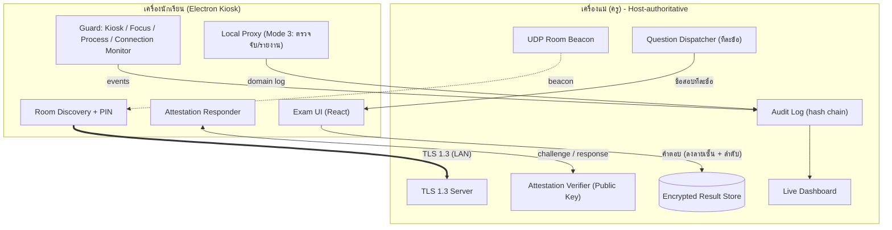
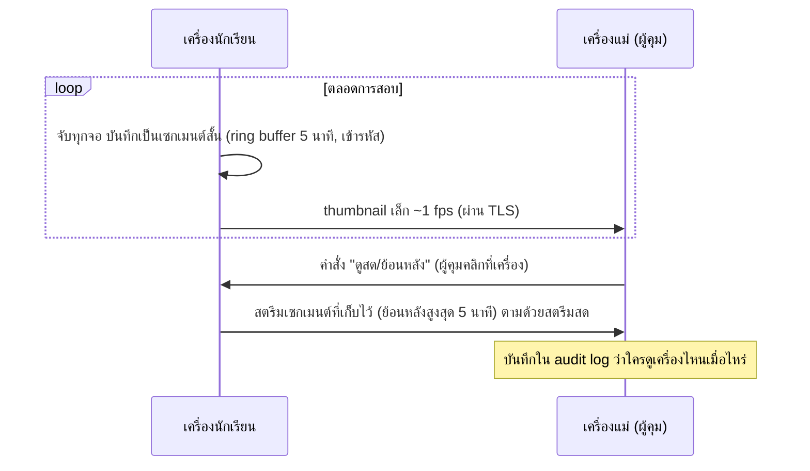

# ZT-Exam: Architecture & Concept (v2)

ระบบสอบในห้องคอมผ่านเครือข่าย LAN (สไตล์ Minecraft LAN) สำหรับ Windows / macOS / Linux
เอกสารนี้สรุป arc ล่าสุดหลังการหารือ และแทนที่ฉบับก่อนหน้า

> รายละเอียดเทคโนโลยีดูที่ [tech-stack.md](./tech-stack.md)

---

## 1. หลักการออกแบบ (Design Principles)

1. **ตรวจจับและฟ้อง (Detect & Report) เป็นหลัก** ไม่ใช่ป้องกันสมบูรณ์ เป้าหมายคือทำให้ "ไม่คุ้มที่จะโกง" และถ้าโกงก็ต้องมีหลักฐาน
2. **Host-authoritative** เครื่องแม่ (ครู) เป็นแหล่งความจริงของข้อสอบ เวลา คำตอบ และ audit log ไม่เชื่อใจเครื่องนักเรียน
3. **ลดสิ่งที่อยู่บนเครื่องเด็ก** ส่งข้อสอบทีละข้อ ข้อล่วงหน้าไม่มีอยู่ในเครื่องเด็ก
4. **Fail-closed** ถ้า heartbeat หรือ attestation ล้มเหลว ให้ freeze การสอบและแจ้งเครื่องแม่ทันที
5. **ซื่อสัตย์กับขีดจำกัด** ซอฟต์แวร์กันการถ่ายรูปจอ การลอกเพื่อนข้างเคียง มือถือ หรือ VM/hypervisor ที่ซ่อนตัวไม่ได้ทั้งหมด (ดูหัวข้อ 8)

---

## 2. ภาพรวมระบบ



เครื่องนักเรียนคุยกับเครื่องแม่เท่านั้น ไม่ต่อ cloud ตรง ๆ Cloud (ถ้ามี) เป็นแค่ที่สำรองผลหลังสอบ โดยเครื่องแม่เป็นผู้อัปโหลด

---

## 3. ส่วนประกอบหลัก

### 3.1 สถาปัตยกรรมแยกแกนหลักกับโมดูลการสอบ (Core Platform vs. Pluggable Exam Modules)
เพื่อให้ระบบรองรับรูปแบบการสอบใหม่ๆ ในอนาคต (เช่น **โมดูลข้อสอบ Dynamic Form** และ **โมดูลสอบเขียนโค้ดด้วย In-App Code IDE** แบบ LeetCode/HackerRank) โดยไม่ต้องรื้อระบบเครือข่ายหรือระบบกันโกงใหม่ เราแยกโค้ดออกเป็น 2 ชั้นชัดเจน:

1. **Core Platform ("Exam OS / Shell"):**
   - ดูแลทุกอย่างที่ใช้ร่วมกันในทุกการสอบ: LAN Discovery, TLS 1.3 + Room PIN, Attestation, Kiosk Lock, Watermark, Deep Cheat Detection (Phase 3a), Audit Hash Chain & Dashboard Triage (Phase 3b), และ Screen Monitoring 5 นาที (Phase 3c)
   - มีท่อส่งข้อความกลาง (`MODULE_PACKET_ENVELOPE`), ระบบนับเวลาจากเครื่องแม่, และบริการ Autosave/Recovery พื้นฐานให้ทุกโมดูลเรียกใช้
2. **Pluggable Exam Modules (`src/modules/<moduleId>/`):**
   - แต่ละโมดูลเป็นอิสระต่อกันและลงทะเบียนผ่าน `ExamModuleRegistry` โดยมีสัญญา (Interface Contract) 4 ส่วน:
     - `shared`: Zod schemas ของไฟล์ข้อสอบ, ข้อมูลที่ส่งให้นักเรียน, และโครงสร้างคำตอบ
     - `main` (Embedded Backend): ตัวจัดการส่งโจทย์ (Dispatcher), ตัวตรวจความถูกต้อง (Validator), ตัวตรวจให้คะแนน (Grader), และตัว Save/Load/Export ไฟล์ประจำโมดูล
     - `renderer/host`: หน้าจอสร้างข้อสอบ (Builder), แผงดูความคืบหน้า, และหน้าตรวจผลสอบของโมดูลนั้น
     - `renderer/student`: หน้าจอทำข้อสอบของนักเรียนสำหรับโมดูลนั้น (เรนเดอร์อยู่ภายใต้ Kiosk HUD และ Watermark ของ Core)
   - **รายการโมดูลตามแผนงาน:**
     - **`dynamic-form` Module (Phase 6 & 7):** ระบบฟอร์มข้อสอบแบบ Dynamic สไตล์ Google Forms รองรับ Input 12 ชนิด ส่งทีละข้อ สลับลำดับข้อ/ตัวเลือกต่อคน Save/Load ไฟล์ `.ztform` ตรวจเฉลยทันที และ Export เป็น CSV/Excel
     - **`code-ide` Module (Phase 8 - ในอนาคต):** ระบบสอบเขียนโปรแกรมด้วย IDE ภายในแอป (Monaco multi-file tree, หน้าต่างโจทย์, รันตรวจ Test cases, เปรียบเทียบ stdout/stderr)
     - **`external-url` Module (Phase 8 - โหมดเสริม):** ตัวครอบลิงก์เว็บสอบภายนอกภายใต้ `WebContentsView` + Whitelist

### 3.2 LAN Discovery และช่องทางสื่อสาร
- **UDP broadcast** ประกาศห้อง (ชื่อห้อง, port, cert fingerprint)
- **TCP + TLS 1.3** ใช้ self-signed cert ชั่วคราวต่อห้อง
- **ข้อควรระวัง:** beacon ทาง UDP ไม่มีการยืนยันตัวตน คนในวง LAN ปลอมได้ จึงต้องมี **Room PIN/รหัสสั้นที่ครูแสดงบนจอ** ให้นักเรียนกรอก แล้วใช้ยืนยัน fingerprint ของเครื่องแม่ (เช่น HMAC ของ fingerprint ด้วย PIN) ก่อนเชื่อใจ

### 3.3 Attestation (เซ็นไฟล์แอปแบบ Arma 3)
- Build ปล่อยจริงสร้าง **manifest** (SHA-256 ของไฟล์ทั้งหมด) และเซ็นด้วย **Ed25519 private key ที่อยู่กับ dev เท่านั้น** เครื่องแม่ถือเฉพาะ public key
- ตอน join: เครื่องแม่ส่ง **nonce**, client ตอบ HMAC ของข้อมูลไฟล์/โค้ดที่กำลังรัน พร้อม manifest + ลายเซ็น
- **ผูก attestation กับ TLS session** (ใช้ TLS exporter ผสมใน HMAC) และ **ส่ง challenge ใหม่แบบสุ่มเวลาตลอดการสอบ** เพื่อลดความเสี่ยงแบบ relay (นักเรียนรันโปรแกรมแท้อีกตัวไว้ตอบแทน)
- ถ้าตรวจพบไม่ตรง: ปฏิเสธการเข้าห้องหรือ freeze + แจ้งครู
- **ข้อจำกัด:** ไม่มี hardware root of trust (TPM) จึงเป็นการ "ยกระดับความยาก" ไม่ใช่การรับประกัน

### 3.4 ระบบตรวจจับ (Detection Suite)
ทุก event ส่งไปเครื่องแม่แบบ real-time และบันทึกใน audit log

| ตัวตรวจ | ตรวจอะไร |
|---|---|
| Kiosk / Focus | หน้าต่างเสียโฟกัส, ออกจากโหมดเต็มจอ, ความพยายามสลับแอป |
| Process Monitor | โปรแกรมที่รันอยู่เทียบ blacklist/whitelist (เช่น เครื่องมือ AI, remote desktop, screen share, debugger) |
| Connection Monitor | การเชื่อมต่อเครือข่ายรายโปรเซส เทียบกับสิ่งที่อนุญาต (จับ app ที่ออกเน็ตโดยไม่ผ่าน proxy) |
| Integrity Watchdog | ตรวจ hash ไฟล์/โฟลเดอร์ที่ควบคุม (แอป, VS Code profile, extensions) ระหว่างสอบ |
| Env / Launch Guard | ตรวจ command-line flag และ environment ที่น่าสงสัยตอนเริ่มแอป |
| VM / Remote Detection | สัญญาณว่ารันใน VM หรือถูก remote (ผลเป็นสัญญาณเตือน ไม่ใช่ข้อสรุป) |
| Heartbeat | ขาดสัญญาณ = freeze และแจ้งครู |

**Policy การตรวจจับมาจากเครื่องแม่ต่อห้อง** (blacklist/whitelist, ช่วงเวลา poll, น้ำหนักของแต่ละ event) ส่งมาแบบเซ็นลายเซ็นตอน join ไม่ฝังตายใน repo และสุ่มช่วงเวลา poll เพื่อไม่ให้ผู้ที่อ่านซอร์สรู้กติกาตายตัวแล้วหลบได้ง่าย

### 3.5 Audit Log แบบ Hash Chain
- เครื่องแม่เก็บ event แบบ append-only โดยแต่ละรายการมี `hash(prev_hash + event)` แก้ย้อนหลังแล้วจะตรวจพบ
- ใช้เป็นหลักฐานประกอบการพิจารณา ไม่ตัดสินอัตโนมัติ

### 3.6 Dashboard Triage (หัวใจของโมเดล "ตรวจจับและฟ้อง")

สอบในห้องสอบจริงที่มีผู้คุม ผู้คุมเดินดูทุกคนไม่ไหว Dashboard ของครูจึงทำหน้าที่ **คัดว่าต้องไปตรวจใคร** แทนการเฝ้าทั้งห้อง ระบบไม่ตัดสินแทนคน แค่ชี้เป้า

| ส่วนประกอบ | รายละเอียด |
|---|---|
| **ระดับความรุนแรง** | ปกติ / เฝ้าระวัง / วิกฤต เช่น เสียโฟกัสครั้งเดียว = เฝ้าระวัง, เปิดโปรแกรมต้องห้ามหรือไฟล์แอปไม่ตรง = วิกฤต |
| **สรุปต่อคน** | คะแนนความน่าสงสัยจาก event ถ่วงน้ำหนัก (ไม่ใช่นับจำนวนเฉยๆ) เรียงคนที่สูงสุดไว้บนสุด |
| **Timeline หลักฐานต่อคน** | รายการ event ตามเวลา ดึงจาก audit log (hash chain) เพื่อดูประกอบการตรวจ |
| **แจ้งเตือนเฉพาะวิกฤต** | สี/เสียงเบา ๆ เด่นชัด ไม่รบกวนทั้งห้อง และไม่เตือนถี่เกินจนผู้คุมเมิน (ป้องกัน alert fatigue) |
| **จัดการผู้ถูก flag** | ทำเครื่องหมาย "ตรวจแล้ว" + บันทึกหมายเหตุ, ส่งข้อความเตือนไปเครื่องนั้น, Freeze เครื่อง |
| **สรุปหลังสอบ** | Export รายงานเหตุการณ์ต่อคน พร้อมหมายเหตุของผู้ตรวจ |

- **ไม่มีผังที่นั่ง** (ตัดสินใจไม่ทำ) ผู้คุมระบุตัวนักเรียนจากชื่อ/รหัสในรายการ
- **สัญญาณแบบอ่อน (ทางเลือก):** รูปแบบเวลาตอบที่ผิดปกติ เช่น เวลาต่อข้อสั้นมากผิดปกติ หรือหยุดนานแล้วตอบรัว ๆ ใช้เป็นข้อมูลประกอบเท่านั้น ไม่ใช่ข้อสรุปและไม่ตัดสินอัตโนมัติ
- **ข้อจำกัด:** พฤติกรรมที่ซอฟต์แวร์ไม่เห็น (เช่น มือถือ) จะไม่ขึ้นแดง ผู้คุมต้องคุมด้วยกติกาห้อง

### 3.7 Screen Monitoring (ดูหน้าจอนักเรียนจากเครื่องแม่)

เสริม Dashboard Triage: ผู้คุมคลิกที่คนแดงแล้วดูหน้าจอได้ทันที โดย **เก็บภาพไว้ที่เครื่องนักเรียนเพียง 5 นาทีล่าสุด และสตรีมไปเครื่องแม่เมื่อถูกเรียกดูเท่านั้น**



- **จับครบทุกจอ** ที่ OS เห็น (แยกต่อ display) ด้วย `desktopCapturer`
- **Thumbnail ทุกเครื่อง:** ขนาดเล็ก ~1 เฟรม/วินาที เพื่อให้ Dashboard เห็นภาพรวม ไม่สตรีมเต็มความละเอียดทุกเครื่องตลอดเวลา (หนักเกินไป)
- **Ring buffer 5 นาที ในเครื่องนักเรียน:**
  - บันทึกเป็นเซกเมนต์สั้น ๆ (เช่น 10 วินาที) แล้วหมุนทับ เหลือเฉพาะ 5 นาทีล่าสุด
  - เข้ารหัสด้วยคีย์ต่อ session ที่เครื่องแม่สร้างให้ และลบทิ้งเมื่อจบการสอบ
  - **ไม่ส่งไปเครื่องแม่เองจนกว่าจะถูกเรียกดู** ข้อมูลส่วนใหญ่จึงอยู่ที่เครื่องนักเรียนและไม่รวมศูนย์
- **Pull on demand:** เครื่องแม่สั่ง "ดู" → client สตรีมเซกเมนต์ที่เก็บไว้ทันที แล้วต่อด้วยภาพสด
- **Pin on critical:** เมื่อเกิด event วิกฤต ระบบล็อกเซกเมนต์ช่วงนั้นไม่ให้ถูกทับ (ยังเก็บที่เครื่องนักเรียน) จนกว่าจะถูกดึงดูหรือจบการสอบ ส่วน event ที่ไม่ถึงวิกฤต Dashboard แสดงเวลานับถอยหลังที่เหลือก่อนหลักฐานถูกทับ
- **Audit:** ทุกครั้งที่ผู้คุมเปิดดูถูกบันทึกลง audit log (ผู้ดู, เครื่องเป้าหมาย, เวลา)
- **Transport:** MVP ใช้ TLS ที่มีอยู่ (ภาพย่อ JPEG / เซกเมนต์วิดีโอ) ภายหลังเพิ่ม **WebRTC** สำหรับ live view (DTLS-SRTP เข้ารหัสในตัว วิ่งบน UDP)

**ข้อจำกัดและข้อควรระวัง**
- **Virtual desktop:** จับ desktop ที่ซ่อนอยู่ไม่ได้ จึงตรวจจับและฟ้องการสลับ desktop แทน
- **แพลตฟอร์ม:** macOS ต้องให้สิทธิ์ Screen Recording (หรือใช้ MDM), Linux ต้องใช้ X11 เพราะ Wayland ต้องขออนุญาตผ่าน portal ทุกครั้ง
- **`setContentProtection` ชนกับสตรีม:** หน้าต่างข้อสอบอาจเป็นสีดำในภาพที่จับ ต้องทดสอบจริง และตัดสินใจเลือกปิดการป้องกันเพื่อให้ผู้คุมเห็นจอครบ
- **ภาพมาจาก client:** เครื่องที่ถูกควบคุมระดับ VM/hypervisor ส่งภาพปลอมได้ attestation ช่วยได้ระดับหนึ่งเท่านั้น
- **ถ้าแอปถูกปิดหรือเครื่องหลุด:** buffer หายไปด้วย แต่ heartbeat จะแจ้งครูทันที
- **ความเป็นส่วนตัว:** จอนักเรียนอาจเผยข้อมูลส่วนตัว ควรประกาศนโยบายล่วงหน้า จำกัดสิทธิ์ผู้ดู และไม่ส่งภาพออกถ้าไม่ถูกเรียกดู
- ไม่เห็นมือถือเหมือนเดิม

---

## 4. โหมดการสอบ (ครูเลือกตอนสร้างห้อง)

| โหมด | รายละเอียด | เครือข่ายฝั่งนักเรียน |
|---|---|---|
| **1. Closed** | Kiosk เต็มจอ ทำข้อสอบในแอปอย่างเดียว | ไม่ใช้อินเทอร์เน็ต (คุยแต่เครื่องแม่) |
| **2. In-App Docs** | แบ่งจอ: ข้อสอบ + WebView เอกสาร | ตรวจ URL กับ whitelist ใน WebView, ผิดกติกา = ฟ้อง |
| **3. External Tools** | อนุญาตโปรแกรมภายนอก เช่น VS Code | Local proxy บันทึก/รายงานโดเมน + Connection Monitor ฟ้องการต่อเน็ตที่ไม่ผ่าน proxy |

**Policy ต่อห้อง:** `enforcement: report-only | block-and-report` (ค่าตั้งต้นของ Mode 3 คือ report-only ตามแนวทาง "ตรวจจับและฟ้อง")

### Mode 3: VS Code ที่ควบคุมได้
- เปิด VS Code จากแอปด้วยโปรไฟล์ที่เราคุม (`--user-data-dir`, `--extensions-dir`) พร้อม extension ที่ติดตั้งและตรวจ hash ไว้ล่วงหน้า
- ปิดฟีเจอร์ AI ของ VS Code ผ่านการตั้งค่า (ต้องตรวจสอบชื่อ setting กับเวอร์ชันที่ใช้) และไม่เปิด Marketplace
- Integrity Watchdog ตรวจ settings และโฟลเดอร์ extension ตลอดการสอบ
- Proxy ใช้ whitelist แบบ default-deny กรองที่ `CONNECT host:443` ให้ proxy resolve DNS เอง ไม่พึ่งการ sniff SNI อย่างเดียว (ECH ซ่อน SNI ได้)

---

## 5. Open Source Model

- **เปิดซอร์ส:** โปรโตคอล, UI, ระบบข้อสอบ, proxy, ตัวตรวจจับ (ความปลอดภัยของ crypto ไม่พึ่งการปิดซอร์ส)
- **เก็บเป็นความลับ:** Ed25519 **private signing key** และ build/release pipeline ที่เซ็นไฟล์จริง
- Fork ที่ไม่มีลายเซ็นที่เครื่องแม่เชื่อถือ จะเข้าห้องสอบไม่ได้
- **กติกาตรวจจับไม่ได้ปลอดภัยด้วยการเปิดซอร์ส:** ต่างจาก crypto ถ้าผู้สอบอ่านเจอว่า blacklist มีอะไรหรือ poll ทุกกี่วินาที ก็หลบได้ง่ายขึ้น จึงให้ policy มาจากเครื่องแม่ต่อห้อง (เซ็นลายเซ็น) ไม่เก็บ blacklist จริงไว้ใน repo และสุ่มช่วงเวลา poll
- **การจัดการ private key:** เป็นจุดล้มเหลวจุดเดียว ควรเซ็นบนเครื่อง offline หรือฮาร์ดแวร์คีย์ มี key rotation และแผน revoke ถ้าคีย์หลุด
- อย่าเข้าใจว่า "เปิดซอร์สแล้ว bypass ไม่ได้" ความปลอดภัยยังมีขีดจำกัดตามหัวข้อ 8

---

## 6. ข้อมูลและ Cloud

- เครื่องแม่เป็นแหล่งข้อมูลหลัก เก็บผลแบบเข้ารหัสตอนเก็บ (at rest)
- ไม่เข้ารหัส RAM แบบซับซ้อน (ไม่คุ้มเมื่อข้อปัจจุบันต้องเป็น plaintext ใน renderer) เก็บแค่ TLS + at-rest encryption และ zeroize buffer ที่ควบคุมเองได้
- Cloud sync เป็นตัวเลือกภายหลัง: เครื่องแม่อัปโหลดผลเข้ารหัสไปยัง API ของเราเอง หลังสอบ

---

## 7. โครงสร้างโปรเจกต์ (Modular Architecture)

```text
lan-exam-system/
├── ai-docs-dev/                 # เอกสาร arc, tech stack และแผนงานราย phase
├── native/                      # Native addon (keyboard hook, window/overlay inspector)
├── src/
│   ├── shared/                  # Types, IPC contracts, Core protocol & Module interfaces
│   │   └── module-contract.ts   # สัญญากลางสำหรับทุก Exam Module
│   ├── main/                    # Electron Main (Core Platform)
│   │   ├── network/             # UDP discovery, TLS 1.3 server/client, framing
│   │   ├── core-host/           # Session manager, timer, audit hash chain, triage engine
│   │   ├── guard/               # Deep cheat detection (Phase 3a)
│   │   ├── screen/              # 1fps thumbnails & 5-min encrypted ring buffer (Phase 3c)
│   │   ├── proxy/               # Local CONNECT proxy & VS Code controller (Mode 3)
│   │   └── attestation/         # Ed25519 manifest & TLS-bound challenge
│   ├── preload/                 # Sandboxed contextBridge
│   ├── renderer/                # React + Vite + Tailwind (Core Shell)
│   │   └── src/
│   │       ├── core-host/       # Room creator, Triage dashboard, Screen viewer modal
│   │       └── core-student/    # Room join, Kiosk HUD, Watermark overlay, Freeze screen
│   └── modules/                 # Pluggable Exam Feature Modules (แยกตามรูปแบบการสอบ)
│       ├── registry.ts          # ExamModuleRegistry (ลงทะเบียนโมดูลทั้งหมด)
│       ├── dynamic-form/        # โมดูลฟอร์มข้อสอบ Dynamic สไตล์ Google Forms (Phase 6 & 7)
│       │   ├── shared/          # Schema 12 input types, validation & answer key types
│       │   ├── main/            # Dispatcher ทีละข้อ, shuffler, auto-grader, .ztform & CSV I/O
│       │   └── renderer/        # FormBuilder UI, Responses/Grading UI, Student Form Runner
│       └── code-ide/            # (อนาคต - Phase 8) โมดูลสอบเขียนโค้ดด้วย In-App IDE
│           ├── shared/          # Workspace schema, test-case definitions
│           ├── main/            # Code runner sandbox, test-case evaluator
│           └── renderer/        # Multi-file Monaco IDE, test runner console
├── scripts/                     # Build, fuses, sign manifest (private key อยู่นอก repo)
└── electron-builder.yml
```

---

## 8. Threat Model และขีดจำกัดที่ยอมรับ

| ภัยคุกคาม | ระดับการรับมือ |
|---|---|
| ดักฟัง/แก้ข้อมูลใน LAN | **กันได้** (TLS 1.3 + PIN-verified fingerprint) |
| แก้ไฟล์แอป / ใช้ client ปลอม | **ตรวจจับได้ส่วนใหญ่** (signed manifest + challenge ผูก TLS) |
| เปิดแอป AI / remote / โปรแกรมต้องห้าม | **ตรวจจับและฟ้อง** (process + connection monitor) แต่มีช่องเปิดแล้วปิดเร็วหรือเปลี่ยนชื่อ |
| ข้อสอบข้อล่วงหน้ารั่ว | **ลดความเสี่ยงมาก** (ส่งทีละข้อ) |
| ลอกเพื่อนข้าง ๆ | **ลดได้** (สลับข้อ/ตัวเลือกต่อคน) |
| ถ่ายรูปจอ / มือถืออีกเครื่อง / ผู้ช่วยนอกห้อง | **กันไม่ได้** ใช้ watermark ตามรอย และมาตรการนอกซอฟต์แวร์ |
| VM / hypervisor / kernel cheat ที่ซ่อนตัว | **กันไม่ได้แน่นอน** (ไม่มี hardware root of trust) ยอมรับว่าต้นทุนสูงสำหรับผู้โกง |
| ผู้โกงที่มีสิทธิ์ Admin | ข้ามการป้องกันระดับ OS ได้ จึงเน้นตรวจจับ + หลักฐาน และควรจัดเครื่องห้องแล็บให้นักเรียนเป็น standard user |
| ใช้ AI ผ่านมือถือ | **ซอฟต์แวร์ไม่เห็นและไม่แดง** Watermark/การสลับข้อไม่ช่วยกับ AI จัดการด้วยกติกาห้องสอบ (เก็บมือถือ) + ผู้คุม + ออกแบบข้อสอบให้ AI ช่วยได้น้อย |
| ใช้ AI บนเครื่องสอบ (เว็บ/extension/gateway เอง) | **ตรวจจับและฟ้องได้ดี** ด้วย whitelist แบบ default-deny ที่ proxy + connection monitor ถ้าต้องการให้ "ไม่ใช่ allow ก็ใช้ไม่ได้" ให้เปิด `block-and-report` |
| Local AI บนเครื่องห้องคอม | เสี่ยงต่ำถ้าคุมสิทธิ์เครื่อง (ไม่มี admin, ปิด USB/boot) และมี process monitor |
| เว็บใน whitelist ถูกใช้เป็นทางผ่าน | ลดโดย whitelist ให้น้อยที่สุดเฉพาะเอกสารที่จำเป็น (proxy เห็นแค่ระดับโดเมน ไม่เห็น path) |
| ผู้อ่านซอร์สเลี่ยงกติกาตรวจจับ | policy จากเครื่องแม่ + สุ่มเวลา poll (ดูหัวข้อ 3.4, 5) |

**หลักคิด:** ทำให้การโกงต้องใช้ความพยายามสูง และทุกความพยายามมีโอกาสถูกบันทึก ผลลัพธ์ที่ได้ใช้ประกอบการตัดสินใจของครู

### สภาพแวดล้อมที่ควรมี (นอกโค้ด ให้ผลคุ้มที่สุด)
1. **สอบในห้องสอบจริงที่มีผู้คุม** ผู้คุมใช้ Dashboard (หัวข้อ 3.6) ตรวจเฉพาะคนที่ถูก flag
2. **จัดการเครื่องห้องแล็บ:** นักเรียนเป็น standard user, ปิด USB/boot จากภายนอก, ติดตั้งโปรแกรมเองไม่ได้, ไม่มี VM ตัดภัยจาก kernel cheat, VM และ portable AI ได้มากกว่าโค้ดทุกชั้น
3. **กติกาห้องสอบเรื่องมือถือ:** เก็บไว้ในกระเป๋าหรือหน้าห้อง ซอฟต์แวร์ทำแทนไม่ได้
4. **ออกแบบข้อสอบให้ AI ช่วยได้น้อย:** ใช้ไฟล์/โค้ด/ข้อมูลเฉพาะของข้อสอบ ถามเหตุผลเชิงบริบท ลดเวลาต่อข้อ และใช้สอบปากเปล่าสุ่มตามหลังจากมี flag

---

## 9. Roadmap (รายละเอียดแผนงานแยกตาม Phase)

แผนการพัฒนาแบบละเอียดแยกอยู่ในโฟลเดอร์ [`ai-docs-dev/plan/`](./plan/00-overview.md):

0. **[Phase 0 – Foundation & Scaffolding](./plan/phase-0-foundation.md):** โครงสร้างโปรเจกต์ `electron-vite`, TypeScript, React, Tailwind, Type-safe IPC (Zod), Crypto primitives, SQLite storage
1. **[Phase 1 – Network Core](./plan/phase-1-network-core.md):** UDP discovery, TLS 1.3 server/client, ยืนยันตัวตนเครื่องแม่ด้วย Room PIN, Framed protocol schema, Heartbeat & Auto-reconnect
2. **[Phase 2 – Exam Core (MVP)](./plan/phase-2-exam-core.md):** Question dispatcher ส่งทีละข้อ, ช้อยส์/ตอบสั้น/อัตนัย, สลับข้อ/ตัวเลือกและสุ่มพารามิเตอร์ต่อคน, Watermark, Autosave & Crash recovery, Kiosk UI
3. **[Phase 3a – Deep Cheat Detection Engine](./plan/phase-3a-cheat-detection.md):** Signed dynamic policy, ตรวจจับไฟล์ที่เปลี่ยนชื่อหนี (PE VersionInfo/Bundle ID), ดักโปรเซสเปิด-ปิดเร็วระดับมิลลิวินาที, ตรวจจับ Stealth Overlay (`WDA_EXCLUDEFROMCAPTURE`), ตรวจ OS DNS Cache, ดัก Synthetic Input (`LLKHF_INJECTED`) และ Clipboard ข้ามอุปกรณ์
4. **[Phase 3b – Audit Hash Chain & Dashboard Triage](./plan/phase-3b-audit-and-triage.md):** Audit log แบบ Cryptographic Hash Chain, คำนวณคะแนนความน่าสงสัยรวมเหตุการณ์ซ้ำ, และหน้าจอ Dashboard คัดกรองคนแดง (Triage) พร้อม Timeline หลักฐาน
5. **[Phase 3c – Screen Monitoring](./plan/phase-3c-screen-monitoring.md):** จับภาพครบทุกจอ, Thumbnail ~1 fps, Ring buffer เข้ารหัส 5 นาทีในเครื่องนักเรียน (เซกเมนต์ละ 10 วินาที), Pin on critical, Pull-on-demand ผ่าน TLS
6. **[Phase 4 – Attestation & Hardening](./plan/phase-4-attestation-hardening.md):** Ed25519 signed manifest, Challenge-response ผูกกับ TLS Exporter ตลอดการสอบ, Native OS keyboard hook, Launch guard & Electron Fuses
7. **[Phase 5 – Mode 2 & Mode 3](./plan/phase-5-modes-2-3.md):** In-App Docs (`WebContentsView` + URL whitelist), Controlled VS Code profile + Local HTTP CONNECT proxy + Integrity watchdog
8. **[Phase 6 – `dynamic-form` Module (UI & `.ztform`)](./plan/phase-6-dynamic-form-builder.md):** ระบบสร้างฟอร์มสไตล์ Google Forms รองรับ Input ครบ 12 ประเภท, ตั้งเฉลยและคะแนนรายข้อ, และ Save/Load ฟอร์มเป็นไฟล์ `.ztform` เพื่อนำเข้าเครื่องแม่
9. **[Phase 7 – `dynamic-form` Module (Backend, Grading & Export)](./plan/phase-7-form-backend-grading-export.md):** Backend ฝังในตัวแอปเครื่องแม่ (Electron Main + SQLite), ตรวจเฉลยอัตโนมัติทันที, แก้เฉลยตรวจใหม่ทั้งห้อง, และส่งออกคำตอบเป็น CSV/Excel หรือ `.ztresults`
10. **[Phase 8 – `code-ide` Module (Part 1: IDE UI & Builder)](./plan/phase-8-code-ide-ui.md):** หน้าจอ In-App IDE (Monaco Multi-file, Test Console, Sandboxed Live Preview) และหน้าสร้างโจทย์ `.ztcode` รองรับ **Java, Python, HTML/CSS, React, JS, TS**
11. **[Phase 9 – `code-ide` Module (Part 2: External Runtime Engine)](./plan/phase-9-code-ide-runtime.md):** เรียกใช้ Runtime ภายนอกในเครื่อง (`javac`/`java`, `python`, `node`) + Offline `esbuild`/React Bundler & Headless DOM Runner พร้อมจำกัดเวลาและทรัพยากร
12. **[Phase 10 – `code-ide` Module (Part 3: Backend & Code Grader)](./plan/phase-10-code-ide-backend.md):** Embedded Backend สำหรับรันตรวจ Hidden Test Cases, คิวตรวจขนาน, หน้าเปิดดูโค้ด/Diff/Code Playback, และส่งออกคะแนน CSV + โฟลเดอร์ซอร์สโค้ด
13. **[Phase 11 – `code-ide` Module (Part 4: Testing & Verification)](./plan/phase-11-code-ide-testing.md):** ทดสอบการรันและตรวจคำตอบครบทั้ง 6 ภาษา, Stress test ตัดจบ Infinite loop, และทดสอบ End-to-End ของโมดูล IDE
14. **[Phase 12 – Post-MVP Extensions](./plan/phase-12-post-mvp.md):** Cloud sync หลังสอบ, สมการคณิตศาสตร์ออฟไลน์ (KaTeX), และ External URL mode
